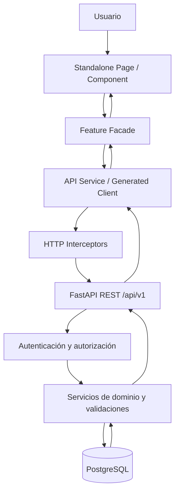
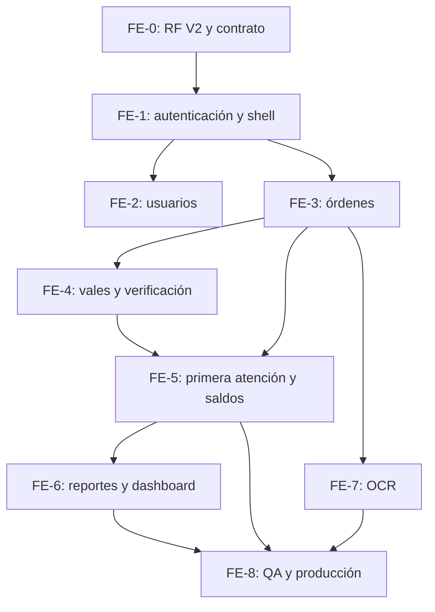

# PLAN_FRONTEND.md
# Plan de implementación del frontend — Estación de Servicio San José

**Proyecto:** Sistema de control de órdenes de compra y vales de combustible  
**Entidad:** Estación de Servicio San José  
**Sedes:** San José y Santa Marta  
**Frontend:** Angular + TypeScript  
**Backend de referencia:** FastAPI + PostgreSQL  
**API:** REST, prefijo propuesto `/api/v1`  
**Idioma de interfaz:** Español  
**Idioma técnico:** Inglés  
**Versión del documento:** 2.0  
**Base funcional:** `REQUERIMIENTOS_FUNCIONALES_SAN_JOSE_V2.md`  
**Contrato técnico de referencia:** `PLAN_BACKEND_SAN_JOSE_V2.md`  
**Estado:** Plan técnico en implementación. El repositorio Angular y FastAPI están disponibles; los endpoints y DTOs deben contrastarse con el código backend antes de integrar cada flujo.

---

# 1. Información general

## 1.1. Descripción del sistema

El frontend permitirá al personal de la Estación de Servicio San José administrar órdenes de compra, capturar los vales físicos durante su primera atención, registrar los galones realmente despachados y realizar la verificación administrativa posterior de cada atención. El sistema opera con información centralizada para las sedes San José y Santa Marta.

El flujo comienza con el registro de una orden de compra por Administrador u Oficina. Cuando el cliente presenta un vale, el Grifero consulta la orden y el saldo del combustible solicitado. Si el vale todavía no existe, captura sus datos junto con el primer despacho en una única operación. Si ya existe, consulta su saldo y registra una nueva atención parcial. Posteriormente, Oficina compara la información capturada con el documento físico recibido y registra el resultado de la verificación.

## 1.2. Objetivo del frontend

Proporcionar una aplicación web accesible desde computadoras y teléfonos móviles que permita ejecutar los flujos definidos en los RF V2, mostrando los datos y estados entregados por FastAPI sin sustituir las validaciones de negocio del backend.

El frontend no será la fuente de verdad de saldos, estados, permisos, identidad del usuario, sede ni fecha/hora de los despachos. Su responsabilidad es presentar la información, capturar datos, ofrecer validaciones tempranas y comunicar de forma clara el resultado de cada operación.

## 1.3. Objetivos específicos

- Implementar los 34 requerimientos funcionales RF-001 a RF-034.
- Respetar los tres roles predefinidos: Administrador, Oficina y Grifero.
- Administrar órdenes con una o varias líneas independientes por tipo de combustible.
- Capturar un vale nuevo únicamente durante su primera atención, junto con el despacho inicial.
- Permitir atenciones parciales posteriores sobre el mismo vale.
- Mostrar por separado cantidades autorizadas, cantidades realmente despachadas y saldos de orden y vale.
- Permitir que Oficina verifique la atención contra el vale físico sin duplicar registros ni alterar cantidades.
- Compartir la misma información entre las sedes.
- Implementar dashboard, reportes, filtros, ordenación y exportación PDF/XLSX.
- Incorporar OCR con RapidOCR exclusivamente para PDFs de órdenes de compra, con revisión humana obligatoria.
- Mantener una arquitectura Angular tipada, modular, accesible y comprobable.

## 1.4. Alcance funcional

El frontend cubrirá los seis módulos definidos por RF V2:

| Módulo | Alcance frontend | Requerimientos |
|---|---|---|
| MOD-001. Administración de usuarios y acceso | Registro de usuarios, roles predefinidos, login/logout, habilitación y deshabilitación, consulta de atenciones de griferos por Administrador. | RF-001 a RF-006 |
| MOD-002. Gestión de órdenes de compra | Registro manual/OCR, detalle, búsqueda, paginación, modificación y eliminación condicionada. | RF-007 a RF-012, RF-032, RF-034 |
| MOD-003. Atención de vales y verificación administrativa | Captura de vale en primera atención, consultas, búsqueda, paginación, corrección descriptiva por Administrador, protección de vales atendidos y verificación de Oficina. | RF-013 a RF-019, RF-033 |
| MOD-004. Control de saldos y estados | Consulta de saldos, validación previa, actualización transaccional, estados derivados y consulta compartida entre sedes. | RF-020 a RF-026 |
| MOD-005. Reportes y panel principal | Reportes de órdenes y atenciones, filtros, gráficos interactivos y exportación PDF/XLSX. | RF-027 a RF-031 |
| MOD-006. OCR para órdenes de compra | Carga temporal de PDF, procesamiento RapidOCR, prellenado del formulario y revisión manual. | RF-034 |

Los 34 RF se cubrirán mediante pantallas, componentes, flujos y servicios. No todos requieren una pantalla independiente: por ejemplo, RF-020 a RF-026 se presentan en los detalles de órdenes, vales y workspace de atención.

## 1.5. Fuera del alcance de esta versión

No se implementarán:

- Autorregistro de usuarios ni portales para clientes, proveedores o instituciones.
- Permisos personalizados por usuario fuera de los tres roles predefinidos.
- Registro anticipado o independiente de vales por Oficina.
- Edición o eliminación directa de atenciones ya confirmadas.
- Corrección de galones despachados hasta que exista un procedimiento de ajuste aprobado y un contrato backend específico.
- Comparación de períodos en reportes.
- Impresión directa de reportes o integración con impresoras.
- Notificaciones proactivas, correo electrónico, WhatsApp o alertas externas.
- Integraciones con facturación, pagos, mapas o sistemas gubernamentales.
- Importación o migración de históricos desde Excel/PDF.
- OCR de vales, fotografías, imágenes o formatos distintos de PDF.
- Almacenamiento permanente de los PDFs procesados por OCR.
- Funcionamiento offline o almacenamiento local de despachos pendientes.
- CRUD administrativo de sedes y tipos de combustible; solo se consultarán los catálogos proporcionados por el backend.
- Reportes personalizados, indicadores de rendimiento o KPI no definidos por RF V2.

Los datos históricos anteriores a la puesta en producción permanecerán fuera del sistema mientras no se apruebe una migración. La consulta histórica dentro de la aplicación incluirá los registros generados desde su puesta en producción.

---

# 2. Cómo leer este plan

Las clasificaciones siguientes permiten distinguir lo establecido por los RF, lo planificado en backend y las decisiones de interfaz:

| Clasificación | Significado |
|---|---|
| **Confirmado por RF V2** | Comportamiento expresamente indicado en los requerimientos funcionales versión 2.0. |
| **Contrato backend propuesto** | Endpoint, permiso, DTO o comportamiento incluido en `PLAN_BACKEND_SAN_JOSE_V2.md`, pendiente de validación contra una implementación real. |
| **Decisión frontend propuesta** | Decisión de navegación, presentación, accesibilidad o experiencia de usuario necesaria para implementar el requerimiento sin inventar reglas de negocio. |
| **Pendiente de aprobación (PD)** | Definición de negocio que aparece en la sección 9 de RF V2 y no debe presentarse como aprobada. |
| **Bloqueado por backend** | Funcionalidad que no se considera integrada hasta que exista un endpoint y contrato manual documentado y verificado. |

## 2.1. Jerarquía de fuentes

1. Requerimientos funcionales V2 y decisiones posteriores formalmente aprobadas por el negocio.
2. Backend realmente implementado y probado, cuando esté disponible.
3. Rutas, permisos, request/response y errores contrastados con la implementación real.
4. `PLAN_BACKEND_SAN_JOSE_V2.md` como contrato técnico planificado.
5. `PLAN_FRONTEND_SAN_JOSE.md` como guía de arquitectura, pantallas y fases.

Cuando un documento técnico proponga un detalle todavía no aprobado en RF V2, el frontend lo tratará como supuesto o pendiente. No se implementará un flujo de negocio solo porque exista una ruta sugerida en un plan técnico.

---

# 3. Documentación analizada y diagnóstico

## 3.1. Documentos de entrada

| Documento | Uso |
|---|---|
| `REQUERIMIENTOS_FUNCIONALES_SAN_JOSE_V2.md` | Fuente funcional principal: 34 RF, 22 reglas de negocio, tres actores, seis módulos, matriz de permisos y 20 puntos pendientes. |
| `PLAN_BACKEND_SAN_JOSE_V2.md` | Referencia de arquitectura, modelos, saldos, endpoints, permisos y fases backend F0–F9. |
| `PLAN_FRONTEND_SAN_JOSE.md` versión 1.0 | Estructura base de arquitectura Angular, convenciones, UX, módulos, pruebas y fases que se actualizan en este documento. |

## 3.2. Estado actual del frontend

**Clasificación:** existe un esqueleto Angular standalone; la aplicación funcional todavía no está implementada.

| Elemento | Estado | Acción propuesta |
|---|---|---|
| Proyecto Angular | Angular standalone en `src/`; todavía sin rutas ni funciones de negocio. | Mantener standalone y organizar por features lazy-loaded. |
| Versiones | Angular 21.2, PrimeNG 21.1, Tailwind CSS 4, Chart.js 4; TypeScript 5.9; Node 24.22.1. | Versiones, `.nvmrc` y lockfile alineados para FE-0. |
| Estilos | Tailwind 4 está importado globalmente; clases utilitarias en línea y tokens San José. | Mantener utilidades Tailwind; excluir mockups HTML del escaneo de producción. |
| UI | PrimeNG con preset Aura y capas CSS configuradas; sin pantallas de negocio. | Definir componentes por feature y verificar accesibilidad en cada flujo. |
| Rutas y layouts | `app.routes.ts` no contiene rutas. | Implementar autenticación y shell en FE-1. |
| Autenticación | Sin servicios ni guards frontend. | Integrar login/logout y consulta de `/auth/me` en FE-1. |
| Servicios API | No existe cliente API ni catálogo contractual frontend. | Documentar endpoints y mantener manualmente tipos TypeScript y servicios tipados. |
| Gráficos | Chart.js está instalado; aún no integrado. | Integrarlo solo en los reportes/dashboard definidos. |
| Calidad | TypeScript strict activado y Prettier disponible; faltan lint, CI y configuración de ambientes. | Completar configuración de calidad y build de CI. |
| Verificación | `npm run build` de producción completó sin advertencias tras excluir los mockups del escaneo; no se ejecutaron pruebas. | Mantener exclusiones y ejecutar la suite cuando se solicite. |

## 3.3. Estado del backend de referencia

El repositorio incluye una implementación FastAPI con routers, servicios, repositorios, esquemas Pydantic, SQL numerado y pruebas unitarias/API. Aún falta un catálogo frontend versionado que contraste cada ruta y DTO con el código actual. El plan backend es una referencia, no una prueba de que todas sus rutas propuestas coincidan con la implementación.

**Hallazgos FE-0:** `/api/v1` contiene autenticación, órdenes, vales, atenciones, verificaciones, usuarios, catálogos, reportes y OCR. Sin embargo, los endpoints de órdenes usan `PurchaseOrderResponse` para todos los roles y `PurchaseOrderItemResponse` incluye `unit_price` y `total_amount`; como `ATTENDANT` tiene `purchase_orders.read`, la respuesta actual no cumple la regla de no exponer precios/importes al Grifero. La separación de DTOs/consultas por rol es un bloqueo de seguridad antes de integrar esas respuestas. También falta contrastar rutas, estados, códigos de error y comportamiento endpoint por endpoint. Ninguna integración frontend se declara lista.

## 3.4. Correcciones realizadas respecto al frontend 1.0

| Tema | Situación anterior | Corrección aplicada |
|---|---|---|
| Numeración funcional | 36 RF y referencias desfasadas. | Se actualiza a RF-001–RF-034. |
| Alta de vales | Formulario y endpoint de creación independiente. | El vale nace junto con el primer despacho del grifero. |
| Atención parcial | Flujo condicionado a decisiones ya resueltas por RF V2. | Se diseña como flujo principal, con atenciones repetidas y saldo remanente. |
| Líneas del vale | Modelo implícito de una sola línea de combustible. | Se contempla estructura de una o varias líneas; la habilitación de varias líneas queda asociada a PD-004. |
| Verificación | No estaba suficientemente separada del despacho. | Bandeja de verificación por atención, con resultado independiente de los saldos. |
| Corrección | Edición genérica del vale. | Solo datos descriptivos permitidos; nunca cantidad real, usuario o fecha/hora de una atención. |
| Permisos | Oficina aparecía creando vales y ciertas consultas eran ambiguas. | Matriz corregida según RF V2. |
| Estados | Estados antiguos y genéricos. | Se distinguen consumo de orden, consumo de vale y verificación física. |
| Reportes | Comparación e impresión incluidas. | Se eliminan ambas funciones; se conservan gráficos y exportación. |
| OCR | RF-036, imágenes y aprobación opcional. | RF-034, solo PDF de orden y revisión humana obligatoria. |
| API | Rutas no alineadas al backend V2. | Se usa el catálogo del plan backend V2. |

---

# 4. Actores y permisos en la interfaz

Los roles de interfaz corresponden a los tres perfiles predefinidos:

| Nombre visible | Rol backend |
|---|---|
| Administrador | `ADMIN` |
| Oficina | `OFFICE` |
| Grifero | `ATTENDANT` |

El frontend usará las claves de permiso que devuelva el backend. Los roles sirven para presentar la experiencia y validar la matriz esperada, pero no reemplazan los permisos efectivos. El servidor será siempre la autoridad de autorización.

## 4.1. Matriz de acceso

| Funcionalidad | Administrador | Oficina | Grifero |
|---|---|---|---|
| Iniciar/cerrar sesión | Sí | Sí | Sí |
| Dashboard | Sí | Sí | No |
| Administrar usuarios y roles | Sí | No | No |
| Habilitar/deshabilitar usuarios | Sí | No | No |
| Registrar, consultar y modificar órdenes | Sí | Sí | No |
| Eliminar orden sin vales asociados | Sí | Sí | No |
| Consultar órdenes y saldos operativos | Sí | Sí | Sí, solo datos necesarios para despacho |
| Consultar vales | Sí | Sí | Sí, solo los necesarios para atender |
| Capturar un vale nuevo junto al primer despacho | Sí, por acceso a todos los módulos | No | Sí, en sus propias atenciones |
| Registrar atenciones posteriores | Sí, por acceso a todos los módulos | No | Sí, en sus propias atenciones |
| Consultar todas las atenciones de griferos | Sí | Según permisos/alcance administrativo definido por backend; no se asumirá acceso global | No |
| Consultar las propias atenciones | Sí | Según alcance definido por backend | Sí |
| Verificar documento físico | Sí | Sí | No |
| Marcar una verificación como observada | Sí | Sí | No |
| Corregir datos descriptivos de un vale | Sí | No | No |
| Editar o borrar una atención confirmada | No mediante edición directa | No | No |
| Reportes, dashboard y gráficos | Sí | Sí | No |
| Exportar reportes PDF/XLSX | Sí | Sí | No |
| Procesar PDF OCR de orden | Sí | Sí | No |

**Importante:** el Administrador tiene acceso a todos los módulos conforme a RF-002. Esto incluye la posibilidad técnica de registrar una atención; si la ejecuta, el registro debe atribuirse al usuario Administrador autenticado, nunca simular que fue un Grifero.

## 4.2. Reglas de presentación y autorización

- Construir el menú a partir de `permissions` devueltos por `GET /api/v1/auth/me` o por el login.
- Ocultar rutas y acciones sin permiso. Un guard frontend no reemplaza la comprobación de backend.
- Ante `401`, invalidar el estado local de sesión y enviar a `/auth/login`.
- Ante `403`, mostrar acceso denegado y no repetir automáticamente la operación.
- El Grifero no verá administración de usuarios, formularios de órdenes, verificación administrativa, corrección descriptiva ni reportes.
- Oficina podrá gestionar órdenes, revisar/verificar atenciones, consultar saldos y usar reportes/OCR. No capturará vales ni despachos.
- No mostrar precios unitarios, importes financieros ni campos administrativos al Grifero. El backend debe omitirlos del DTO; el frontend no debe confiar en ocultar visualmente datos que ya recibió.
- La interfaz no permitirá cambiar manualmente estados de consumo o verificación.
- No ofrecer acciones de edición de una atención confirmada.

---

# 5. Arquitectura frontend Angular

## 5.1. Enfoque arquitectónico

Se utilizará una arquitectura **feature-based**, con componentes standalone y separación entre presentación, estado de pantalla y acceso a datos.

La aplicación será un único frontend responsive. No se utilizarán microfrontends: el dominio y la cantidad de módulos no justifican esa complejidad.

Principios:

- Componentes enfocados en una responsabilidad.
- Servicios API responsables de HTTP y serialización.
- Facades/stores por feature cuando coordinen carga, filtros, mutaciones e invalidación de estado.
- Interfaces y tipos explícitos.
- Reactive Forms tipados para captura y validación.
- Angular Signals para estado de interfaz; RxJS para HTTP, cancelación y composición asíncrona.
- No duplicar reglas de saldo, concurrencia, autorización ni estados de backend.
- No crear abstracciones genéricas sin una necesidad repetida y concreta.
- Cada acción de escritura debe tener estados `idle`, `submitting`, `success` y `error`.
- Ninguna escritura se debe presentar como exitosa antes de recibir respuesta backend.

## 5.2. Flujo de responsabilidades



## 5.3. Responsabilidad de las capas

| Capa | Responsabilidad | No debe hacer |
|---|---|---|
| `pages` | Componer pantallas, leer estado y coordinar acciones. | Ejecutar reglas de saldo ni HTTP directamente. |
| `components` | Renderizar formularios, tablas, tarjetas y diálogos. | Conocer persistencia o decidir permisos de negocio. |
| `facades` | Coordinar carga, filtros, errores, comandos e invalidación. | Reimplementar reglas del servidor. |
| `data-access` | Consumir endpoints y mapear DTOs. | Calcular saldos o decidir autorización. |
| `models` | Definir contratos TypeScript y tipos del dominio. | Contener efectos secundarios. |
| `core` | Configuración, sesión, guards, interceptors y utilidades globales. | Contener lógica de órdenes/vales. |
| `shared` | Componentes visuales y utilidades reutilizables. | Depender de features específicas. |

## 5.4. Estructura de carpetas propuesta

```text
frontend/
├── public/
├── src/
│   ├── app/
│   │   ├── core/
│   │   │   ├── api/
│   │   │   │   ├── generated/
│   │   │   │   ├── api-config.ts
│   │   │   │   └── api-error.mapper.ts
│   │   │   ├── auth/
│   │   │   │   ├── auth.service.ts
│   │   │   │   ├── auth.store.ts
│   │   │   │   ├── auth.models.ts
│   │   │   │   └── current-user.service.ts
│   │   │   ├── guards/
│   │   │   ├── interceptors/
│   │   │   ├── config/
│   │   │   ├── constants/
│   │   │   └── utils/
│   │   ├── layouts/
│   │   │   ├── auth-layout/
│   │   │   └── app-shell-layout/
│   │   ├── shared/
│   │   │   ├── components/
│   │   │   ├── pipes/
│   │   │   ├── validators/
│   │   │   └── models/
│   │   ├── features/
│   │   │   ├── dashboard/
│   │   │   ├── users/
│   │   │   ├── purchase-orders/
│   │   │   ├── vouchers/
│   │   │   ├── attendances/
│   │   │   ├── verifications/
│   │   │   ├── balances/
│   │   │   ├── reports/
│   │   │   └── ocr/
│   │   ├── app.config.ts
│   │   └── app.routes.ts
│   ├── environments/
│   ├── styles/
│   ├── index.html
│   └── styles.css
├── angular.json
├── package.json
├── package-lock.json
├── tsconfig.json
└── README.md
```

Estructura interna de ejemplo para órdenes:

```text
features/purchase-orders/
├── data-access/
│   └── purchase-orders-api.service.ts
├── models/
│   └── purchase-order.models.ts
├── pages/
│   ├── purchase-order-list.page.ts
│   ├── purchase-order-create.page.ts
│   ├── purchase-order-detail.page.ts
│   └── purchase-order-edit.page.ts
├── components/
│   ├── purchase-order-form.component.ts
│   ├── purchase-order-table.component.ts
│   ├── purchase-order-items-editor.component.ts
│   └── purchase-order-balance.component.ts
├── state/
│   └── purchase-orders.facade.ts
└── purchase-orders.routes.ts
```

No será obligatorio crear todos los archivos si la feature es pequeña. No se mantendrán carpetas ni clases vacías para completar artificialmente la estructura.

---

# 6. Stack tecnológico y dependencias

## 6.1. Tecnologías propuestas

| Componente | Selección propuesta | Propósito |
|---|---|---|
| Framework | Angular standalone 21.2 | Aplicación web. |
| Lenguaje | TypeScript 5.9 | Tipado y mantenimiento. |
| Runtime | Node.js 24.22.1 | Desarrollo y compilación; versión fijada en `.nvmrc`. |
| Gestor | npm 11.19.1 | Dependencias y lockfile. |
| Estilos | Tailwind CSS 4 | Utilidades en línea, tema y responsive. |
| UI | PrimeNG 21.1 | Tablas, formularios, diálogos, menús y selectores. |
| HTTP | Angular `HttpClient` | Consumo de FastAPI. |
| Estado | Signals + RxJS | Estado local y flujos asíncronos. |
| Formularios | Reactive Forms tipados | Captura y validación. |
| Gráficos | Chart.js 4.6 | Gráficos RF-030. |
| Contrato API frontend | Catálogo manual de endpoints y DTOs alineado con FastAPI | Servicios Angular y tipos TypeScript mantenidos en el repositorio. |
| Pruebas unitarias | Vitest 4 | Pruebas unitarias. |
| E2E | Playwright | Flujos completos de navegador. |

Las dependencias frontend están fijadas mediante `package.json` y `package-lock.json`; ejecutar `npm ci` para respetar las versiones resueltas.

## 6.2. Criterios de selección

- PrimeNG será la biblioteca UI principal; no se mezclará con Angular Material.
- SCSS se utilizará para tema y estilos específicos.
- Chart.js se limitará a los gráficos requeridos.
- No se incorporará NgRx inicialmente; Signals y facades por feature son suficientes.
- No se agregará una biblioteca frontend para generar PDF o Excel; los archivos los genera el backend.
- No se agregará IndexedDB ni service worker para almacenar despachos offline.
- Los mensajes/toasts se usarán solo para feedback de operaciones, no como sistema de notificaciones persistentes.
- Los tipos y servicios API se mantendrán manualmente; los cambios de contrato requieren revisar juntos el esquema backend y el catálogo frontend.

## 6.3. Calidad de código

Configurar:

- TypeScript `strict`.
- ESLint y formatter compatibles con Angular.
- Imports organizados y sin dependencias circulares.
- Componentes standalone y lazy loading.
- Prohibición de `any`, salvo frontera externa justificada y acotada.
- Formularios y DTOs tipados.
- Funciones puras para transformación de DTOs.
- Componentes presentacionales sin llamadas HTTP.
- Manejo centralizado de errores y estados de escritura.
- Revisión de bundle y dependencias antes de producción.
- No convertir cantidades decimales financieras o de galones a `number` para efectuar cálculos de negocio en el navegador.

---

# 7. Convenciones de nomenclatura y rutas

## 7.1. Idioma

Todos los nombres técnicos serán inglés. Los textos visibles, títulos, botones y validaciones serán español.

## 7.2. Convenciones de código

| Elemento | Convención | Ejemplo |
|---|---|---|
| Carpetas | `kebab-case` | `purchase-orders` |
| Archivos | `kebab-case` | `purchase-order-list.page.ts` |
| Componentes | `PascalCase` | `PurchaseOrderListPage` |
| Servicios | `PascalCase` | `PurchaseOrdersApiService` |
| Facades | `PascalCase` | `PurchaseOrdersFacade` |
| Tipos | `PascalCase` | `PurchaseOrderResponse` |
| Variables | `camelCase` | `availableGallons` |
| Métodos | `camelCase` | `loadPurchaseOrders()` |
| Constantes | `UPPER_SNAKE_CASE` | `DEFAULT_PAGE_SIZE` |

## 7.3. Rutas Angular

Las rutas serán minúsculas, en inglés y `kebab-case`.

```text
/auth/login

/app/dashboard
/app/users
/app/users/new
/app/users/:userId
/app/users/:userId/attendances

/app/purchase-orders
/app/purchase-orders/new
/app/purchase-orders/:orderId
/app/purchase-orders/:orderId/edit
/app/purchase-orders/:orderId/attendances/new

/app/vouchers
/app/vouchers/:voucherId
/app/vouchers/:voucherId/attendances/new

/app/attendant/workspace
/app/attendances
/app/attendances/pending-verification
/app/attendances/:attendanceId
/app/balances

/app/reports/purchase-orders
/app/reports/attendances

/access-denied
/not-found
```

Reglas de navegación:

- **No existe** `/app/purchase-orders/:orderId/vouchers/new`: el vale se captura dentro de la primera atención.
- La ruta `.../attendances/new` de una orden inicia el formulario combinado de vale nuevo + primer despacho.
- La ruta `.../vouchers/:voucherId/attendances/new` registra una atención posterior del vale existente.
- Las rutas de verificación son administrativas y solo se habilitan a `OFFICE` y `ADMIN`.
- No existe `/app/reports/comparison`.
- No existe ruta ni acción para imprimir reportes.
- Las rutas de listado, búsqueda, filtros, página y orden se podrán reflejar en query parameters para permitir recarga y compartir una consulta sin perder contexto.

---

# 8. Diseño de interfaz y experiencia de usuario

## 8.1. Principios visuales

La interfaz priorizará legibilidad, claridad de saldos y rapidez operacional.

- Idioma español.
- Fechas visibles en formato `dd/MM/yyyy`; la API utilizará el formato contractual `YYYY-MM-DD`.
- Fecha y hora de atención se mostrarán en la zona de negocio acordada (`America/Lima`, pendiente de confirmación PD-019). El frontend no inventará timestamps.
- Cantidades expresadas en galones y con la precisión recibida del backend.
- Cantidades autorizadas, despachadas y saldo deben distinguirse visualmente.
- Los saldos se mostrarán separados por tipo de combustible; nunca se sumarán combustibles diferentes para aparentar un saldo fungible.
- Los estados se mostrarán con texto y distintivo visual, no solo con color.
- Un vale puede conservar saldo propio y, sin embargo, no poder despacharse porque la orden se agotó. La pantalla debe comunicar ambas cosas por separado.
- Los errores explicarán qué ocurrió y cuál es la siguiente acción posible, sin exponer stack traces.

## 8.2. Layouts

### `AuthLayout`

- Contenedor simple para acceso.
- Formulario de inicio de sesión con correo y contraseña.
- Mensajes de validación y error.
- No incluir recuperación de contraseña hasta que se apruebe y exista endpoint.

### `AppShellLayout`

- Header con usuario, rol y sede asignada cuando corresponda.
- Navegación lateral en escritorio.
- Menú compacto o drawer en móvil.
- Área de contenido y breadcrumbs.
- Acción de cerrar sesión.
- Menú generado desde permisos efectivos.
- No mostrar selector de sede operativo hasta resolver PD-014 y tener un contrato backend explícito.

## 8.3. Pantalla inicial por rol

| Rol | Destino | Contenido |
|---|---|---|
| `ADMIN` | `/app/dashboard` | Dashboard, administración de usuarios, órdenes, atención, vales, verificación, reportes y catálogos de consulta. |
| `OFFICE` | `/app/dashboard` | Dashboard, órdenes, bandeja de verificación, consulta de vales, saldos, reportes, exportación y OCR. |
| `ATTENDANT` | `/app/attendant/workspace` | Búsqueda de órdenes, consulta de saldos, localización de vales existentes y registro de atenciones propias. |

## 8.4. Workspace del Grifero

La pantalla móvil del Grifero es prioritaria y deberá permitir:

1. Identificar al usuario autenticado y mostrar la sede asignada/activa devuelta por backend.
2. Buscar una orden por número o entidad/institución.
3. Consultar cantidad autorizada, galones realmente despachados y saldo por tipo de combustible, sin precios ni importes.
4. Seleccionar el combustible de la línea de orden correspondiente.
5. Buscar un vale ya capturado por su número y consultar autorización, acumulado atendido y saldo restante.
6. Cuando el vale sea nuevo, capturar sus datos dentro del formulario de primer despacho, no en un formulario independiente.
7. Ingresar la cantidad realmente despachada en esa visita.
8. Revisar el resumen de vale, combustible y cantidad antes de confirmar.
9. Recibir confirmación del backend y los saldos actualizados.
10. Consultar las atenciones propias autorizadas.

El Administrador también podrá realizar el flujo de atención conforme a su permiso general. La autoría debe reflejar el usuario autenticado que ejecutó realmente la operación.

## 8.5. Experiencia de primera atención y atención posterior

### Primera atención: vale nuevo

El formulario combinado presentará dos bloques diferenciados:

**Datos del vale (autorización del documento):**
- Emisor/entidad emisora.
- Número del vale.
- Una o varias líneas autorizadas por tipo de combustible, según decisión PD-004.
- Cantidad autorizada en el documento por cada línea.

**Despacho de esta visita (consumo real):**
- Una o varias líneas que se despacharán en la visita actual.
- Galones efectivamente entregados por línea.
- Al menos una línea con cantidad real positiva, según contrato backend.
- Resumen de los saldos consultados antes de confirmar.

El frontend enviará una sola solicitud para crear el vale y su primer despacho. Si la solicitud falla, no mostrará el vale como creado.

### Atención posterior: vale existente

- Cargar el vale y sus líneas desde backend.
- Mostrar autorización original, acumulado atendido y saldo propio.
- Mostrar el saldo de la línea de orden relacionada.
- Permitir ingresar solamente cantidades reales de la visita actual.
- No permitir cambiar la cantidad originalmente autorizada.
- Enviar nueva atención contra el `voucher_id` existente.
- No volver a capturar ni crear otro vale.

## 8.6. Verificación de Oficina

La verificación es una operación distinta del despacho:

- La bandeja mostrará una fila por atención pendiente u observada, identificada por número de vale, orden, institución, combustible, galones de esa visita, fecha/hora y usuario que la ejecutó.
- Oficina abre el detalle y compara los datos con el documento físico recibido.
- Si coinciden, selecciona **Verificar**.
- Si no coinciden, podrá registrar **Observar** con una descripción obligatoria, conforme al contrato backend propuesto.
- Una observación no edita ni elimina el despacho, no cambia cantidades y no modifica saldos.
- La UI distinguirá estado de consumo del vale y estado de verificación de cada atención.
- La resolución posterior de observaciones permanece pendiente de PD-011; no se inventará un botón para corregir cantidades.

## 8.7. Responsive

| Dispositivo | Comportamiento |
|---|---|
| Móvil | Navegación compacta, tarjetas, formularios de una columna, acciones táctiles y workspace prioritario. |
| Tablet | Navegación compacta y formularios de una o dos columnas según ancho. |
| Escritorio | Sidebar, tablas paginadas, filtros y paneles de detalle. |
| Pantallas grandes | Ancho de lectura limitado, sin estirar formularios innecesariamente. |

## 8.8. Estados de pantalla

Toda pantalla que consulta o modifica datos deberá contemplar:

- `loading`: indicador o skeleton.
- `success`: contenido cargado.
- `empty`: sin resultados o sin registros pendientes.
- `error`: error recuperable y opción de reintento cuando sea seguro.
- `forbidden`: acceso denegado.
- `submitting`: acción en curso; evita doble envío.
- `conflict`: conflicto de saldo, duplicidad o estado (`409`).
- `unknown-outcome`: la conexión se interrumpió y no se conoce el resultado de una escritura. No mostrar éxito ni generar una clave de idempotencia nueva hasta resolver el intento previo.

## 8.9. Accesibilidad

- Labels asociados a todos los inputs.
- Semántica correcta para botones, tablas, encabezados y diálogos.
- Navegación por teclado y foco visible.
- Estados comunicados con texto además de color.
- Errores asociados al control correspondiente.
- Confirmaciones accesibles para modificaciones, eliminaciones y despachos.
- No depender solo de hover para revelar información crítica.
- Mensajes de éxito/error anunciables por lectores de pantalla.

---

# 9. Contrato e integración con FastAPI

## 9.1. Base URL

La API utilizará el prefijo propuesto:

```text
/api/v1
```

La URL absoluta se configurará por ambiente. Ningún componente concatenará direcciones de API de manera manual.

## 9.2. Estado del contrato

Los endpoints siguientes se describen en `PLAN_BACKEND_SAN_JOSE_V2.md` y deben contrastarse con el backend ejecutable. Todos se consideran **planificados / pendientes de verificar** hasta completar esa revisión.

Antes de integrar cada feature se deberá:

1. Revisar rutas, parámetros, permisos, DTOs y códigos de error directamente en routers y schemas del backend.
2. Mantener un catálogo contractual versionado en `docs/API_INTEGRATION.md`.
3. Escribir y actualizar manualmente los tipos TypeScript de request/response y sus servicios.
4. Registrar discrepancias y resolverlas con backend antes de implementar adaptaciones locales.
5. Añadir pruebas de servicios para los requests y responses acordados.

## 9.3. Convenciones HTTP y formatos

- Rutas privadas con `Authorization: Bearer <access_token>`.
- JSON para operaciones comunes.
- `multipart/form-data` para OCR.
- Fechas documentales: `YYYY-MM-DD`.
- Timestamps: ISO 8601 con zona horaria.
- Decimales: los tipos frontend los preservarán como strings y el backend validará precisión y límites. No convertir cantidades/precios a `number` para cálculos.
- Listados paginados: `items` y `pagination`.
- Filtros y ordenación: solo parámetros admitidos por cada endpoint.
- Archivos PDF/XLSX: respuesta binaria (`Blob`) con nombre de archivo desde headers cuando esté presente.
- Atención: incluir `Idempotency-Key` UUID generado en cliente una sola vez por operación lógica.

Formato paginado propuesto:

```json
{
  "items": [],
  "pagination": {
    "page": 1,
    "page_size": 20,
    "total": 0,
    "pages": 0
  }
}
```

Parámetros previstos por backend: `page`, `page_size`, `search`, `order_number`, `voucher_number`, `institution`, `date_from`, `date_to`, `status`, `verification_status`, `sort_by` y `sort_order`. En reportes también se contemplan `user_id`, `fuel_type_id` y `group_by` (`hour`, `day`, `week`, `month`). No todos aplican a todos los endpoints.

## 9.4. Catálogo de endpoints planificados

### Salud

| Método | Endpoint | Uso frontend | Estado |
|---|---|---|---|
| GET | `/api/v1/health/live` | Diagnóstico técnico de vida. | Planificado |
| GET | `/api/v1/health/ready` | Diagnóstico de disponibilidad backend/DB. | Planificado |

No requieren una pantalla de negocio.

### Autenticación y usuarios

| Método | Endpoint | Uso frontend | RF | Permiso propuesto |
|---|---|---|---|---|
| POST | `/api/v1/auth/login` | Iniciar sesión. | RF-003 | Público |
| POST | `/api/v1/auth/logout` | Revocar la sesión propia. | RF-005 | Usuario autenticado |
| GET | `/api/v1/auth/me` | Recuperar usuario, rol, sede y permisos efectivos. | RF-002/RF-003 | Usuario autenticado |
| GET | `/api/v1/users` | Listar usuarios. | RF-001/RF-004 | `users.read` |
| POST | `/api/v1/users` | Crear usuario. | RF-001/RF-002 | `users.create` |
| GET | `/api/v1/users/{user_id}` | Consultar usuario. | RF-001/RF-004 | `users.read` |
| PATCH | `/api/v1/users/{user_id}/role` | Asignar/cambiar rol predefinido. | RF-002 | `users.manage_roles` |
| PATCH | `/api/v1/users/{user_id}/status` | Habilitar/deshabilitar cuenta. | RF-004 | `users.manage_status` |
| GET | `/api/v1/users/{user_id}/attendances` | Consultar atenciones del grifero. | RF-006 | `attendances.read_all` |

No utilizar `DELETE /users/{id}` para borrar usuarios. La interfaz debe usar el endpoint de estado.

### Catálogos

| Método | Endpoint | Uso frontend | RF | Permiso |
|---|---|---|---|---|
| GET | `/api/v1/branches` | Consultar sedes. | RF-025 | Autenticado |
| GET | `/api/v1/fuel-types` | Consultar combustibles activos. | RF-007/RF-019 | Autenticado |

No se crearán pantallas CRUD de sedes ni combustibles.

### Órdenes de compra

| Método | Endpoint | Uso frontend | RF | Permiso |
|---|---|---|---|---|
| GET | `/api/v1/purchase-orders` | Búsqueda, filtros, ordenación y paginación. | RF-009/RF-010/RF-032 | `purchase_orders.read` |
| POST | `/api/v1/purchase-orders` | Crear orden y todas sus líneas. | RF-007 | `purchase_orders.create` |
| GET | `/api/v1/purchase-orders/{order_id}` | Detalle, líneas, vales y saldos. | RF-008 | `purchase_orders.read` |
| PATCH | `/api/v1/purchase-orders/{order_id}` | Modificar datos permitidos. | RF-011 | `purchase_orders.update` |
| DELETE | `/api/v1/purchase-orders/{order_id}` | Eliminación condicionada si no tiene vales. | RF-012 | `purchase_orders.delete` |

### Vales y atenciones

| Método | Endpoint | Uso frontend | RF | Permiso |
|---|---|---|---|---|
| GET | `/api/v1/vouchers` | Buscar, filtrar, ordenar y paginar vales. | RF-015/RF-016/RF-033 | `vouchers.read` |
| GET | `/api/v1/vouchers/{voucher_id}` | Consultar cabecera, líneas, atenciones y saldos. | RF-014/RF-015 | `vouchers.read` |
| PATCH | `/api/v1/vouchers/{voucher_id}/descriptive-data` | Corregir campos descriptivos permitidos. | RF-017 | `vouchers.correct_descriptive_data` |
| DELETE | `/api/v1/vouchers/{voucher_id}` | No se expone como acción normal; backend bloquea vales atendidos. | RF-018 | Según backend |
| GET | `/api/v1/attendances` | Listar atenciones según rol y alcance. | RF-006/RF-013/RF-028 | `attendances.read` |
| GET | `/api/v1/attendances/{attendance_id}` | Consultar detalle de un despacho. | RF-006/RF-013 | `attendances.read` |
| POST | `/api/v1/purchase-orders/{order_id}/attendances` | Crear vale nuevo y su primer despacho en una operación. | RF-019 | `attendances.create` |
| POST | `/api/v1/vouchers/{voucher_id}/attendances` | Registrar atención parcial posterior. | RF-019 | `attendances.create` |

**No existe alta normal independiente de vales.** No implementar `POST /vouchers` ni pantalla de pre-registro por Oficina. La creación del vale forma parte de la primera atención.

### Verificación administrativa

| Método | Endpoint | Uso frontend | RF | Permiso |
|---|---|---|---|---|
| GET | `/api/v1/attendances/pending-verification` | Bandeja de atenciones pendientes u observadas. | RF-013 | `attendances.verify` |
| POST | `/api/v1/attendances/{attendance_id}/verifications` | Guardar decisión `VERIFIED` u `OBSERVED`. | RF-013 | `attendances.verify` |
| GET | `/api/v1/attendances/{attendance_id}/verifications` | Consultar historial de verificaciones. | RF-013 | `attendances.verify` |

La verificación se aplica al registro de atención y no modifica las cantidades del despacho ni los saldos.

### Saldos

| Método | Endpoint | Uso frontend | RF | Permiso |
|---|---|---|---|---|
| GET | `/api/v1/balances/purchase-orders/{order_id}` | Saldos por línea/tipo de combustible. | RF-020/RF-024/RF-025/RF-026 | `balances.read` |
| GET | `/api/v1/balances/vouchers/{voucher_id}` | Saldos por línea del vale. | RF-021/RF-024/RF-026 | `balances.read` |
| GET | `/api/v1/balances/overview` | Resumen de órdenes/saldos visibles al usuario. | RF-024/RF-025 | `balances.read` |

### Reportes y dashboard

| Método | Endpoint | Uso frontend | RF | Permiso |
|---|---|---|---|---|
| GET | `/api/v1/reports/purchase-orders` | Reporte de órdenes y saldos. | RF-027/RF-029 | `reports.read` |
| GET | `/api/v1/reports/attendances` | Reporte de atenciones y agrupaciones temporales. | RF-028/RF-029 | `reports.read` |
| GET | `/api/v1/dashboard` | Datos agregados de gráficos. | RF-030 | `reports.read` |
| GET | `/api/v1/reports/purchase-orders/export` | Exportación PDF/XLSX de órdenes. | RF-031 | `reports.export` |
| GET | `/api/v1/reports/attendances/export` | Exportación PDF/XLSX de atenciones. | RF-031 | `reports.export` |

No crear endpoints ni pantallas para comparación de períodos o impresión directa.

### OCR

| Método | Endpoint | Uso frontend | RF | Permiso |
|---|---|---|---|---|
| POST | `/api/v1/ocr/purchase-order-previews` | Procesar temporalmente un PDF y devolver campos candidatos. | RF-034 | `ocr.process` |

El endpoint no registra órdenes, no acepta vales ni fotografías y no debe conservar el PDF como documento permanente.

## 9.5. Respuestas y errores

El cliente API centralizará la traducción de errores. La interfaz debe reconocer como mínimo:

| HTTP | Caso | Comportamiento frontend |
|---|---|---|
| 400 | Solicitud mal formada | Mensaje general, conservar formulario. |
| 401 | Token inválido, expirado o sesión revocada | Limpiar sesión y redirigir al login. |
| 403 | Rol/permisos insuficientes | Mostrar acceso denegado. |
| 404 | Recurso inexistente o fuera del alcance | Mostrar que no se encontró el registro. |
| 409 | Duplicado, saldo insuficiente, orden/vale bloqueado, conflicto o idempotencia | Mostrar mensaje de negocio, actualizar datos relacionados y conservar captura cuando sea seguro. |
| 413 | PDF excede límite | Informar límite devuelto/documentado por backend. |
| 415 | Tipo de archivo no admitido | Aceptar solo PDF en OCR. |
| 422 | Validación de campos | Vincular errores a los controles correspondientes. |
| 429 | Límite de solicitudes | Informar y permitir reintento controlado. |
| 500/503 | Error interno/servicio no disponible | Mensaje seguro; no declarar éxito ni perder el contexto. |

Para `409 VOUCHER_ALREADY_EXISTS`, si backend devuelve el ID del vale existente, ofrecer abrir ese vale y continuar por la ruta de atención posterior. No volver a enviar el alta del primer vale.

Para `409 IDEMPOTENCY_KEY_REUSED`, no generar automáticamente otra clave ni volver a enviar un payload diferente. Registrar el error técnico y solicitar una nueva operación explícita solo después de resolver el intento anterior.

## 9.6. Cliente API y contratos manuales

- Implementar servicios de transporte con Angular `HttpClient` y tipos TypeScript escritos en el frontend.
- Mantener un catálogo versionado de endpoint, método, parámetros, permisos, request, response y errores esperados.
- Revisar cambios de contrato en conjunto con backend y actualizar los tipos/servicios correspondientes.
- Mantener separados los DTOs de Grifero y Oficina/Administrador cuando difieran por permisos o confidencialidad.
- Centralizar autenticación, manejo de errores e idempotencia en infraestructura compartida; evitar duplicar esa lógica en componentes.

---

# 10. Autenticación, sesión y seguridad

## 10.1. Flujo de inicio de sesión

1. El usuario accede a `/auth/login`.
2. Ingresa correo y contraseña.
3. `AuthService` envía `POST /api/v1/auth/login`.
4. El backend verifica credenciales, estado de cuenta y sesión.
5. La respuesta incluye token, datos mínimos del usuario, rol, sede y permisos efectivos.
6. El frontend inicializa `AuthStore` y navega según rol/permisos.
7. Al iniciar la aplicación, se consulta `/api/v1/auth/me` cuando exista una sesión/token válido y se reconstruye el contexto autorizado.

No se implementará recuperación de contraseña ni cambio de contraseña hasta que se confirme el procedimiento (PD-007) y exista contrato backend.

## 10.2. Almacenamiento del token

Decisión frontend propuesta, sujeta a revisión de seguridad con backend:

- Preferir almacenamiento en memoria del access token.
- No guardar contraseñas, token ni datos sensibles en `localStorage`.
- Si el backend entrega únicamente JWT y no proporciona refresh/cookie de sesión, una recarga completa puede requerir autenticarse de nuevo. Esta limitación debe aceptarse explícitamente o resolverse mediante un mecanismo seguro de sesión antes de producción.
- No crear mecanismos de renovación de token que el backend no soporte.
- No enviar credenciales o tokens en URL.
- Nunca registrar tokens en consola, logs ni herramientas de analítica.

No se elegirá `sessionStorage` o `localStorage` como solución automática para persistencia sin una revisión de riesgo XSS y aprobación de la estrategia.

## 10.3. Cierre de sesión

- Ejecutar `POST /api/v1/auth/logout`.
- Limpiar estado de usuario, permisos y datos privados en memoria.
- Limpiar cachés de features y navegar al login.
- Si la llamada falla por indisponibilidad, limpiar igualmente la interfaz local y mostrar que la revocación remota no pudo confirmarse; el backend debe mantener expiración y revocación.
- No se implementará cierre remoto de sesiones ajenas hasta aprobar PD-008.

## 10.4. Guards e interceptors

- `AuthGuard`: evita acceso no autenticado.
- `GuestGuard`: evita mostrar login a una sesión válida.
- `PermissionGuard`: valida permiso requerido por ruta.
- `AuthInterceptor`: adjunta Bearer token.
- `ApiErrorInterceptor`: mapea errores HTTP y centraliza 401/403.
- Los guards no sustituyen la autorización en servidor.
- Evitar ciclos de redirección cuando `/auth/me` falle.

## 10.5. Habilitación y deshabilitación

- La acción de Administración de usuarios cambiará el estado de una cuenta usando `PATCH /users/{id}/status`.
- Solicitar confirmación antes de deshabilitar o habilitar.
- Mostrar claramente la acción y el estado actual.
- Al deshabilitar, el backend revoca sesiones activas; el frontend no intentará borrar sus registros históricos.
- No usar DELETE físico de usuarios.
- El frontend no permitirá deshabilitar al último Administrador activo si el backend informa esa restricción; el backend debe ser quien aplique la validación definitiva.

---

# 11. Gestión de estado y datos

## 11.1. Estrategia

- Signals para estado de presentación y selección local.
- RxJS para peticiones HTTP, debounce, cancelación y concurrencia en UI.
- Facades por feature para coordinar datos y acciones complejas.
- El estado de formularios no se mezclará con el estado de sesión.
- El estado remoto se invalidará después de mutaciones y se volverá a consultar.
- No mantener saldos como fuente persistente local.
- No implementar sincronización offline ni colas locales.

## 11.2. Estado por área

| Área | Estado principal | Invalidación |
|---|---|---|
| Auth | Usuario, rol, permisos, sede, sesión | Login/logout/401 |
| Users | Listado, detalle, filtros, estado | Crear/rol/habilitar/deshabilitar |
| Purchase orders | Listado, detalle, líneas, saldos devueltos | Crear/modificar/eliminar |
| Vouchers | Listado, detalle, líneas, atenciones y estados | Crear primera atención, atención posterior o corrección descriptiva |
| Attendances | Historial, detalle, filtros | Nueva atención; consulta siempre desde API |
| Verifications | Bandeja, decisión, historial | Nueva verificación |
| Balances | Saldos por línea de orden/vale | Después de atención o cambio autorizado de orden |
| Reports | Filtros, tablas y series | Cambio de filtros; consulta al backend |
| OCR | Archivo temporal, preview, candidatos y estado | Procesar, cancelar o limpiar formulario |

## 11.3. Saldos: fuente de verdad

El frontend nunca calculará el saldo oficial. Presentará los campos devueltos por backend:

- **Autorizado de orden:** cantidad autorizada para una línea de combustible de la orden.
- **Despachado de orden:** suma de galones reales entregados en todas las atenciones imputadas a esa línea.
- **Saldo de orden:** autorizado de orden menos despachado real.
- **Autorizado de vale:** cantidad indicada en el documento físico por línea de combustible.
- **Despachado de vale:** suma de cantidades reales de todas las atenciones de esa línea del vale.
- **Saldo del vale:** autorizado del vale menos despachado acumulado.

Regla crítica para presentación y pruebas:

> Los galones autorizados en un vale que todavía no han sido despachados no descuentan el saldo de la orden. La orden se descuenta exclusivamente por el consumo real.

Ejemplo ilustrativo que debe poder mostrarse sin cálculos frontend:
- Orden Diesel: 100 galones autorizados.
- Vale A: 10 galones autorizados; primera atención: 5.
- Saldo del vale A: 5.
- Saldo de la orden: 95.
- Un segundo vale autoriza 20 galones y todavía no despacha: el saldo de la orden sigue siendo 95.

## 11.4. Estados de consumo y verificación

El frontend traducirá códigos de backend a etiquetas españolas mediante un mapper centralizado. No cambiará estados manualmente.

| Recurso | Estado API propuesto | Etiqueta de UI | Significado |
|---|---|---|---|
| Línea/orden | `AVAILABLE` | Con saldo | Saldo mayor que cero. |
| Línea/orden | `DEPLETED` | Agotada | Saldo igual a cero. |
| Línea de vale | `PENDING` | Pendiente de atención | Aún no tiene galones despachados y conserva saldo. |
| Línea de vale | `PARTIALLY_ATTENDED` | Parcialmente atendido | Tiene despachos y conserva saldo propio. |
| Línea de vale | `COMPLETED` | Atendido | Saldo propio igual a cero. |
| Línea de vale | `BLOCKED_BY_ORDER_BALANCE` | Sin disponibilidad por saldo de orden | Conserva saldo propio, pero la orden no permite nuevos despachos. |
| Vale agregado | `PARTIALLY_BLOCKED` | Parcialmente bloqueado | Alguna línea conserva saldo propio pero no puede continuar por el saldo de su orden. |
| Verificación | `PENDING` | Pendiente de verificación | Oficina todavía no revisa esa atención. |
| Verificación | `VERIFIED` | Verificado | Oficina confirmó coincidencia con el documento físico. |
| Verificación | `OBSERVED` | Observado | Oficina registró una discrepancia. |

El estado de consumo del vale y el estado de verificación de cada atención se presentan en controles separados. Un vale puede estar `PARTIALLY_ATTENDED` y su última atención `OBSERVED`; un estado no reemplaza al otro.

## 11.5. Información compartida entre sedes

- Las dos sedes consultan la misma fuente central.
- No habrá saldos locales ni réplicas frontend separadas.
- Después de registrar un despacho, se refrescan saldos del vale y de la orden.
- Al volver a una pestaña, después de recuperar foco o tras un conflicto `409`, se volverá a consultar la disponibilidad cuando sea relevante.
- No se implementará polling continuo ni WebSocket sin contrato y necesidad confirmados.
- No prometer actualización instantánea en otra sesión/dispositivo: la interfaz mostrará información actual al consultar/refrescar desde backend.
- La sede que aparece en una atención será la que devuelva backend; no se aceptará un valor de sede escrito en el formulario.

## 11.6. Búsqueda, filtros, paginación y orden

- Búsqueda de órdenes por número/código y entidad/institución; filtros por fecha según RF-009.
- Búsqueda de vales por número, orden y entidad/institución, con rango de fechas opcional según RF-015.
- Paginación en servidor para órdenes y vales (RF-010/RF-016).
- Ordenación de órdenes y vales (RF-032/RF-033) solo por columnas permitidas por backend.
- Debounce en búsqueda de texto y cancelación de peticiones previas.
- Reset de página al cambiar filtros.
- Mantener filtros en query parameters cuando sea apropiado.
- No descargar todos los datos para paginar/ordenar localmente.
- Tamaño de página inicial configurable según contrato documentado; la propuesta backend sugiere 20 por defecto y un máximo de 100, pendiente de verificación.

---

# 12. Modelos y contratos TypeScript

Los modelos TypeScript se mantendrán manualmente y se contrastarán con los schemas y servicios reales del backend. Los siguientes tipos son conceptuales y describen responsabilidades; no deben duplicarse de forma incompatible con los DTOs acordados.

## 12.1. Modelos compartidos

```ts
type UserRole = 'ADMIN' | 'OFFICE' | 'ATTENDANT';

interface CurrentUser {
  id: string;
  firstName: string;
  lastName: string;
  role: UserRole;
  branch?: BranchSummary | null;
  permissions: string[];
}

interface BranchSummary {
  id: string;
  code: string;
  name: string;
}

interface PageResult<T> {
  items: T[];
  pagination: {
    page: number;
    pageSize: number;
    total: number;
    pages: number;
  };
}
```

## 12.2. Modelos de órdenes

```ts
interface PurchaseOrder {
  id: string;
  orderNumber: string;
  siafNumber: string;
  issueDate: string;
  institutionName: string;
  supplierName: string;
  executingUnit: string;
  executingUnitRuc: string;
  status: 'AVAILABLE' | 'DEPLETED';
  items: PurchaseOrderItem[];
}

interface PurchaseOrderItem {
  id: string;
  fuelTypeId: string;
  fuelTypeName: string;
  authorizedGallons: string;
  attendedGallons: string;
  availableGallons: string;
  unitPrice?: string;
  totalAmount?: string;
  status: 'AVAILABLE' | 'DEPLETED';
}
```

Los campos de precio/importes no deben llegar al DTO del Grifero. La opcionalidad anterior es ilustrativa; el contrato definitivo separará DTOs por rol.

## 12.3. Modelos de vales

```ts
interface Voucher {
  id: string;
  purchaseOrderId: string;
  issuerType: string;
  issuerName: string;
  voucherNumber: string;
  status: VoucherStatus;
  items: VoucherItem[];
  attendances: AttendanceSummary[];
}

interface VoucherItem {
  id: string;
  purchaseOrderItemId: string;
  fuelTypeId: string;
  fuelTypeName: string;
  authorizedGallons: string;
  attendedGallons: string;
  remainingGallons: string;
  status: VoucherItemStatus;
}

type VoucherStatus =
  | 'PENDING'
  | 'PARTIALLY_ATTENDED'
  | 'COMPLETED'
  | 'PARTIALLY_BLOCKED';

type VoucherItemStatus =
  | 'PENDING'
  | 'PARTIALLY_ATTENDED'
  | 'COMPLETED'
  | 'BLOCKED_BY_ORDER_BALANCE';
```

No se definirá un `VoucherCreateRequest` para un alta independiente. El DTO de primera atención llevará los datos del vale nuevo y las cantidades reales que se despacharán en la misma operación.

## 12.4. Modelos de atenciones

```ts
interface Attendance {
  id: string;
  voucherId: string;
  performedByUserId: string;
  performedByName: string;
  branchId: string;
  branchName: string;
  occurredAt: string;
  items: AttendanceItem[];
  verificationStatus: 'PENDING' | 'VERIFIED' | 'OBSERVED';
}

interface AttendanceItem {
  id: string;
  voucherItemId: string;
  purchaseOrderItemId: string;
  fuelTypeName: string;
  attendedGallons: string;
}
```

Primera atención, DTO conceptual:

```ts
interface FirstAttendanceRequest {
  newVoucher: {
    issuerType: string;
    issuerName: string;
    voucherNumber: string;
    items: Array<{
      purchaseOrderItemId: string;
      authorizedGallons: string;
    }>;
  };
  attendanceItems: Array<{
    purchaseOrderItemId: string;
    attendedGallons: string;
  }>;
}
```

Atención posterior, DTO conceptual:

```ts
interface SubsequentAttendanceRequest {
  items: Array<{
    voucherItemId: string;
    attendedGallons: string;
  }>;
}
```

La primera operación se envía a `POST /purchase-orders/{order_id}/attendances`; la siguiente, a `POST /vouchers/{voucher_id}/attendances`.

## 12.5. Modelos de verificación

```ts
type VerificationDecision = 'VERIFIED' | 'OBSERVED';

interface VerificationRequest {
  decision: VerificationDecision;
  observation?: string | null;
}

interface AttendanceVerification {
  id: string;
  attendanceId: string;
  decision: VerificationDecision;
  observation?: string | null;
  reviewedByUserId: string;
  reviewedByName: string;
  reviewedAt: string;
}
```

Si la decisión es `OBSERVED`, la interfaz requerirá una observación no vacía, de acuerdo con el contrato backend propuesto. Esta observación no es un ajuste del despacho.

## 12.6. Modelos de saldos y reportes

Los DTOs de saldo serán los devueltos por el endpoint que se acuerde con backend. Los DTOs de reportes/dashboard modelarán únicamente columnas, totales y series presentes en el contrato documentado. No crear campos calculados en cliente para completar datos que el backend no proporcione.

## 12.7. Precisión decimal

- Tratar galones, precios e importes como strings decimales en los modelos y payloads frontend.
- No usar `parseFloat` ni aritmética binaria `number` para validar saldos.
- Validar formato, signo y máximo de decimales localmente para mejorar experiencia, con reglas finales recibidas de backend.
- La precisión sugerida por backend es galones a 3 decimales, precio unitario a 4 e importe a 2; permanece pendiente de aprobación PD-020.
- La interfaz no redondeará ni corregirá silenciosamente importes o cantidades.

---

# 13. Definición de módulos, rutas y pantallas

## 13.1. Módulo de autenticación

**RF:** RF-003 y RF-005.  
**Rutas:** `/auth/login`, `/access-denied`.  
**Permiso:** público para login; autenticación para logout.  
**Servicios:** `AuthService`, `AuthStore`, `CurrentUserService`.

**Pantallas/componentes:**
- Login.
- Mensaje de credenciales inválidas.
- Estado de sesión expirada/revocada.
- Acción de cerrar sesión.

**Reglas:**
- Aceptar correo y contraseña.
- No revelar si falló correo o contraseña.
- No construir recuperación/cambio de contraseña sin aprobación.
- Limpiar estado de usuario y permisos después del logout.
- Navegar por permisos efectivos, no solo por nombre de rol.

## 13.2. Módulo de usuarios

**RF:** RF-001, RF-002, RF-004 y RF-006.  
**Rutas:** `/app/users`, `/app/users/new`, `/app/users/:userId`, `/app/users/:userId/attendances`.  
**Permisos:** `users.read`, `users.create`, `users.manage_roles`, `users.manage_status`, `attendances.read_all`.  
**Servicios:** `UsersApiService`, `UsersFacade`, `AttendancesApiService`.

**Pantallas:**
- Listado de usuarios.
- Alta de usuario.
- Detalle/estado del usuario.
- Atenciones del grifero para Administrador.

**Formulario de usuario:**
- Nombres.
- Apellidos.
- DNI.
- Correo electrónico.
- Contraseña inicial.
- Rol predefinido.
- Sede solo si el contrato de creación/usuario y PD-014 lo establecen.

**Reglas:**
- Solo Administrador crea usuarios y administra roles/estado.
- No existe autorregistro.
- No borrar usuarios físicamente.
- Deshabilitar conserva relaciones históricas.
- No limitar el número de usuarios a seis u ocho: el número es una estimación administrativa pendiente (PD-015).
- Validar duplicidad de DNI/correo usando el error backend.
- No ofrecer edición general de perfil que no esté soportada por endpoint.
- RF-006 corresponde a consulta administrativa de atenciones realizadas por griferos; no convertirla en auditoría universal de todas las acciones del sistema.

## 13.3. Módulo de órdenes de compra

**RF:** RF-007 a RF-012 y RF-032.  
**Rutas:** `/app/purchase-orders`, `/app/purchase-orders/new`, `/app/purchase-orders/:orderId`, `/app/purchase-orders/:orderId/edit`.  
**Permisos:** `purchase_orders.read`, `purchase_orders.create`, `purchase_orders.update`, `purchase_orders.delete`.  
**Servicios:** `PurchaseOrdersApiService`, `PurchaseOrdersFacade`, `CatalogsApiService`.

**Pantallas/componentes:**
- Listado con búsqueda, filtros, paginación y orden.
- Formulario de alta con cabecera y líneas dinámicas.
- Detalle de orden, líneas, vales asociados y saldos.
- Edición de datos permitidos.
- Confirmación de eliminación.

**Campos requeridos conforme a RN-003:**
- Número de orden.
- Expediente SIAF.
- Fecha.
- Proveedor.
- Unidad ejecutora.
- RUC de unidad ejecutora.
- Una o más líneas con tipo de combustible, cantidad autorizada, precio unitario y precio total.

**Reglas:**
- El registro es manual o asistido por OCR; nunca guardar automáticamente al finalizar OCR.
- Cada línea corresponde a un tipo de combustible.
- No mezclar saldos de combustibles diferentes.
- Ordenar desde servidor con `sort_by`/`sort_order` permitidos.
- Antes de eliminar, confirmar y llamar backend. Si existe al menos un vale, backend bloquea y la UI explica el conflicto.
- La modificación debe preservar referencias históricas y no reducir cantidad autorizada por debajo del consumo real.
- Si se elimina una línea con consumo o se intenta disminuir el total por debajo del consumo, mostrar el conflicto que devuelva backend y no descartar el formulario.
- No asumir que una orden pertenece exclusivamente a una sede mientras PD-005 no esté confirmado.

## 13.4. Módulo de consulta y administración de vales

**RF:** RF-014, RF-015, RF-016, RF-017, RF-018 y RF-033.  
**Rutas:** `/app/vouchers`, `/app/vouchers/:voucherId`.  
**Permisos:** lectura según rol; `vouchers.correct_descriptive_data` para Administrador.  
**Servicios:** `VouchersApiService`, `VouchersFacade`.

**Pantallas/componentes:**
- Listado de vales con búsqueda, paginación y orden.
- Detalle del vale con sus líneas, atenciones, cantidades y saldos.
- Historial de verificaciones asociado a cada atención.
- Formulario de corrección descriptiva exclusivo de Administrador.

**Búsqueda:**
- Número de vale.
- Número de orden.
- Entidad/institución.
- Rango de fechas opcional.
- Resultados restringidos por el permiso y alcance de quien consulta.

**Reglas:**
- No hay botón “Registrar vale” ni formulario de pre-registro.
- Los vales se originan en la primera atención del Grifero o Administrador autorizado.
- RF-017 solo permite corregir campos descriptivos expuestos por endpoint. No se permitirá cambiar galones autorizados, cantidades despachadas, usuario, fecha/hora de atención ni datos que alteren la trazabilidad.
- Cambiar un dato que afecte la identificación del vale deberá respetar la unicidad y validaciones del backend.
- No mostrar acción de eliminación para vales atendidos. El backend debe bloquear cualquier intento con conflicto.
- La atención parcial posterior se inicia desde el detalle del vale, no desde una creación de vale.

## 13.5. Módulo de captura y despacho

**RF:** RF-019, RF-022 y RF-023.  
**Rutas:** `/app/attendant/workspace`, `/app/purchase-orders/:orderId/attendances/new`, `/app/vouchers/:voucherId/attendances/new`.  
**Permiso:** `attendances.create` y permisos de consulta correspondientes.  
**Servicios:** `AttendancesApiService`, `AttendancesFacade`, `BalancesApiService`.

**Flujos:**

1. Buscar la orden por número o entidad/institución.
2. Consultar la disponibilidad por tipo de combustible.
3. Identificar si el vale ya existe usando la búsqueda permitida.
4. Si es nuevo, capturar datos documentales y despacho inicial conjuntamente.
5. Si ya existe, consultar saldo y registrar una nueva atención contra ese vale.
6. Mostrar un resumen antes de confirmar.
7. Enviar la operación con una clave de idempotencia.
8. Mostrar el resultado confirmado por backend y refrescar saldos.

**Reglas obligatorias:**
- Un vale nuevo no se persiste separado de su primer despacho.
- En primera atención se envía `new_voucher` y `attendance_items` en una sola operación.
- En atenciones siguientes se envían los `voucher_item_id` y galones reales de esta visita.
- La cantidad autorizada del vale se captura solo en primera atención.
- La cantidad real de esta visita debe ser mayor que cero y no superar saldo del vale ni saldo de orden.
- Se puede despachar menos que la cantidad autorizada: la diferencia queda como saldo del vale.
- La cantidad autorizada de un vale no reduce saldo de la orden; solo lo hacen los galones efectivamente despachados.
- Para un vale con varias líneas, las cantidades se mantienen separadas por combustible. La UI podrá presentar editor dinámico de líneas, sujeto a aprobación PD-004.
- No capturar usuario, sede ni fecha/hora desde el formulario; vienen del backend.
- El usuario verá sus atenciones, según alcance backend; el Administrador podrá consultar las de griferos conforme a RF-006.
- Ninguna operación se almacenará para envío offline.

**Errores y contingencias:**
- `409` por saldo insuficiente: volver a consultar saldo y explicar la diferencia.
- `409 VOUCHER_ALREADY_EXISTS`: abrir el vale existente y continuar mediante atención posterior.
- Corte de conexión con resultado incierto: conservar payload y clave de idempotencia para consultar/reintentar exactamente la misma operación. No generar una nueva clave para el mismo intento.
- Doble clic: bloquear el botón mientras se envía.
- Si el backend rechaza la operación, no mostrar actualización optimista de saldos.

## 13.6. Módulo de saldos

**RF:** RF-020 a RF-026.  
**Rutas:** `/app/balances` y accesos contextuales desde órdenes, vales y workspace.  
**Permiso:** `balances.read`.  
**Servicios:** `BalancesApiService`, `BalancesFacade`.

**Pantallas/componentes:**
- Resumen de saldos.
- Saldo de una orden por combustible/línea.
- Saldo de cada línea de vale.
- Indicadores de disponibilidad, agotamiento y bloqueo por saldo de orden.
- Historial de cantidades autorizadas y reales.

**Reglas:**
- No calcular localmente saldos.
- No sumar combustibles diferentes.
- Diferenciar saldo propio del vale y saldo de su línea de orden.
- Presentar estados devueltos por backend, traducidos por un mapper central.
- Si el vale conserva saldo pero la orden se agotó, mostrar “Saldo del vale pendiente” y “No disponible por saldo agotado de la orden”; no etiquetarlo incorrectamente como atendido.
- Después de una atención confirmada, refrescar balance de orden y vale.
- Las dos sedes consultan la misma fuente central.

## 13.7. Módulo de verificación administrativa

**RF:** RF-013, RF-017 y RF-018.  
**Rutas:** `/app/attendances/pending-verification`, `/app/attendances/:attendanceId`.  
**Permisos:** `attendances.verify`; corrección descriptiva adicional solo Administrador.  
**Servicios:** `VerificationsApiService`, `VerificationsFacade`, `AttendancesApiService`.

**Pantallas/componentes:**
- Bandeja de atenciones pendientes/observadas.
- Detalle de atención y datos del vale.
- Formulario de decisión `VERIFIED`/`OBSERVED`.
- Historial de verificaciones.

**Reglas:**
- Oficina revisa el vale físico recibido contra el registro de atención.
- Si coincide, registra `VERIFIED`.
- Si no coincide, registra `OBSERVED` con observación obligatoria según el contrato backend propuesto.
- La verificación no cambia galones ni saldos.
- No crea un segundo vale ni una segunda atención.
- No se mostrarán botones de editar/eliminar cantidades de atención.
- La corrección descriptiva RF-017 es exclusiva de Administrador y no equivale a corregir la cantidad despachada.
- La resolución de observaciones después del registro queda pendiente PD-011.

## 13.8. Módulo de atenciones e historial

**RF:** RF-006, RF-013, RF-019 y RF-028.  
**Rutas:** `/app/attendances`, `/app/attendances/:attendanceId`, `/app/users/:userId/attendances`.  
**Servicios:** `AttendancesApiService`, `AttendancesFacade`.

**Pantallas:**
- Historial administrativo para Administrador.
- Atenciones de un usuario/grifero desde su detalle.
- Historial de atenciones propias para Grifero si el permiso está habilitado.
- Detalle inmutable de un despacho.

**Reglas:**
- La lista administrativa debe limitarse al alcance permitido por backend.
- Oficina tendrá la bandeja de verificación; no se asumirá que puede consultar todas las atenciones de todos los usuarios si la política no lo autoriza.
- Cada atención mostrará usuario, fecha/hora, sede y líneas reales devueltas por el servidor.
- No permitir editar ni eliminar una atención confirmada.

## 13.9. Módulo de dashboard y reportes

**RF:** RF-027 a RF-031.  
**Rutas:** `/app/dashboard`, `/app/reports/purchase-orders`, `/app/reports/attendances`.  
**Permisos:** `reports.read`, `reports.export`.  
**Servicios:** `ReportsApiService`, `DashboardApiService`, `ReportsFacade`.

**Dashboard:**
- Información agregada de órdenes, saldos y atenciones suministrada por backend.
- Gráficos interactivos con datasets devueltos por API.
- Filtros por fechas, usuario y estado; no agregar filtros no soportados.
- Agrupaciones hora, día, semana o mes cuando el endpoint lo permita.
- Estados vacíos y errores.

**Reportes incluidos:**
1. Órdenes de compra: cantidades autorizadas, cantidades despachadas y saldos por combustible.
2. Vales/atenciones: cantidades reales despachadas, orden, entidad, combustible, fecha/hora, usuario y sede según permisos.
3. Filtros por fecha, usuario y estado.
4. Exportación PDF y Excel con los mismos filtros y permisos de la consulta.

**Reglas:**
- No hay comparación de dos períodos.
- No hay botón imprimir ni vista de impresión.
- No crear KPI, columnas ni fórmulas que no estén aprobadas o devueltas por backend.
- Precios unitarios e importes se mostrarán solo a Administrador/Oficina y según PD-009.
- Gráficos exactos sujetos a PD-010.
- Los filtros que se envían en consulta y exportación deben coincidir.
- El Grifero no accede a dashboard ni reportes.

## 13.10. Módulo OCR

**RF:** RF-034.  
**Ruta:** Integrado en `/app/purchase-orders/new`; no requiere menú independiente.  
**Endpoint:** `POST /api/v1/ocr/purchase-order-previews`.  
**Permiso:** `ocr.process`.  
**Servicio:** `OcrApiService`.

**Flujo:**
1. Usuario Administrador/Oficina abre formulario de nueva orden.
2. Selecciona exclusivamente un archivo PDF.
3. Frontend valida extensión y MIME como primera comprobación; backend vuelve a validar contenido, tamaño y páginas.
4. Envía `multipart/form-data`.
5. Muestra estado de procesamiento y resultado.
6. El backend devuelve candidatos reconocidos para número de orden, expediente SIAF, fecha, proveedor, unidad ejecutora, RUC, combustible, cantidad, precio unitario y total.
7. El frontend precarga campos candidatos y señala los no reconocidos.
8. El usuario revisa y corrige todos los campos.
9. El guardado de la orden se realiza únicamente por `POST /api/v1/purchase-orders` después de la confirmación explícita.
10. Se limpian el archivo, las vistas previas y cualquier URL temporal al finalizar o cancelar.

**Reglas:**
- Solo PDF de orden de compra.
- No OCR de vales ni fotografías.
- No guardar automáticamente al completar OCR.
- El OCR no sustituye la validación del formulario.
- Si el PDF falla, está protegido o no puede leerse, permitir continuar manualmente.
- No almacenar permanentemente el PDF en frontend ni asumir que existe un archivo descargable.
- Tamaño máximo, cantidad de páginas y timeout dependen de PD-012 y configuración backend.
- OCR es RF de alcance vigente; no se debe marcar como opcional ni fuera de alcance. Su integración depende de la disponibilidad real del endpoint F8.

---

# 14. Componentes reutilizables

| Componente | Propósito | Uso |
|---|---|---|
| `PageHeaderComponent` | Título, descripción y acciones. | Todas las páginas. |
| `DataTableComponent<T>` | Listado paginado en servidor. | Usuarios, órdenes, vales y atenciones. |
| `ServerPaginationComponent` | Navegación de páginas backend. | Listados. |
| `SearchFieldComponent` | Búsqueda con debounce. | Órdenes y vales. |
| `DateRangeFilterComponent` | Filtro de fecha desde/hasta. | Órdenes, vales y reportes. |
| `StatusBadgeComponent` | Estado traducido. | Orden, vale y verificación. |
| `GallonsDisplayComponent` | Cantidad y unidad. | Órdenes, vales, saldos y atenciones. |
| `CurrencyDisplayComponent` | Presentar precios/importes autorizados. | Órdenes/reportes Admin-Office. |
| `ConfirmDialogComponent` | Confirmar acciones sensibles. | Modificaciones, eliminaciones y despachos. |
| `FormErrorComponent` | Mensajes de validación. | Formularios. |
| `EmptyStateComponent` | Estado sin resultados. | Listados y reportes. |
| `LoadingSkeletonComponent` | Estado de carga. | Páginas/tablas. |
| `ApiErrorComponent` | Error y reintento seguro. | Consultas. |
| `BranchLabelComponent` | Mostrar sede devuelta por backend. | Header y detalle de atención. |
| `ReportFilterBarComponent` | Filtros compartidos. | Dashboard/reportes. |
| `FuelLineEditorComponent` | Editor de líneas por combustible. | Orden y, si se aprueba PD-004, vale nuevo. |
| `BalanceSummaryComponent` | Diferenciar autorizado, despachado y saldo. | Orden, vale y workspace. |
| `VerificationStatusComponent` | Estado físico por atención. | Bandeja e historial. |
| `IdempotentSubmitDirective` | Evitar doble envío y conservar intento. | Captura de atenciones. |
| `PdfUploadComponent` | Selección temporal de PDF. | OCR de órdenes. |

Los componentes recibirán datos y emitirán eventos. No llamarán endpoints ni contendrán reglas de saldo.

---

# 15. Formularios y validaciones

## 15.1. Estrategia

Utilizar Reactive Forms tipados. La validación frontend sirve para feedback temprano; el backend conserva la autoridad final.

Reglas comunes:
- Mostrar errores por campo y mensajes generales de negocio.
- No limpiar el formulario ante un error recuperable.
- No transformar silenciosamente cantidades.
- Deshabilitar el submit durante una escritura.
- Solicitar confirmación para las operaciones que así lo indican los RF.
- Diferenciar “Cancelar” de “Volver” y evitar pérdida accidental de datos.

## 15.2. Formulario de usuario

Campos: nombres, apellidos, DNI, correo, contraseña inicial y rol. Sede solo cuando el contrato y PD-014 lo determinen.

- DNI tratado como texto para preservar ceros iniciales.
- Correo validado en formato.
- Contraseña no se vuelve a mostrar ni se recupera desde API.
- Roles limitados a `ADMIN`, `OFFICE`, `ATTENDANT`.
- No agregar un selector de permisos individuales.
- Gestionar duplicidad DNI/correo con respuesta backend.

## 15.3. Formulario de orden

- Cabecera requerida según RN-003.
- Una o más líneas de combustible.
- Catálogo de combustible activo desde API.
- Cantidades positivas.
- Precio unitario y total con precisión decimal contractual.
- RUC como texto.
- Eliminar/agregar líneas solo según restricciones de edición.
- Si existe consumo histórico, no permitir en UI reducciones que se sabe que rompen el total despachado; backend validará siempre.
- Mostrar un resumen por línea; no sumar galones de combustibles distintos.

## 15.4. Formulario de primera atención (vale nuevo + despacho)

**No existe formulario independiente de vale.** Este formulario debe contener:

- Orden seleccionada (solo lectura).
- Emisor/entidad emisora.
- Número de vale.
- Tipo de combustible relacionado con una línea de orden.
- Cantidad autorizada indicada en el documento.
- Cantidad real que se entregará en esta visita.
- Una o varias líneas autorizadas y despachadas si PD-004 queda aprobada.
- Resumen con cantidades autorizadas y reales separadas.
- Confirmación explícita.

Validaciones UI:
- Campos documentales obligatorios según RN-004.
- Cada combustible debe corresponder a una línea de la orden.
- Cantidad autorizada mayor que cero.
- Cantidad realmente despachada mayor que cero.
- Cantidad real no mayor a cantidad autorizada de esa línea.
- Cantidad real no mayor al saldo de la línea de orden.
- No calcular el saldo; contrastar con valor actual que devuelve API y aceptar que backend vuelva a validar.
- Una autorización de vale no debe reducir visualmente el saldo de la orden.
- Si el backend detecta duplicado, abrir el vale existente en lugar de insistir en crear uno nuevo.

## 15.5. Formulario de atención posterior

- Mostrar vale y número como solo lectura.
- Mostrar autorización original, atendido acumulado y saldo restante por línea.
- Mostrar saldo de orden asociado.
- Seleccionar cantidades reales para la visita actual.
- No permitir cambiar emisor, número, orden o cantidad autorizada.
- Validar cantidad mayor que cero y no mayor que los saldos devueltos.
- Enviar un nuevo `Idempotency-Key` para una nueva operación lógica; conservar la misma clave para reintentos exactos de esa operación.

## 15.6. Formulario de verificación

- Mostrar datos del vale y de la atención recibida.
- Decisión `VERIFIED` o `OBSERVED`.
- Para `OBSERVED`, requerir descripción de la diferencia.
- Para `VERIFIED`, la observación puede omitirse o ser nula según el contrato confirmado con backend.
- No incluir inputs de galones, usuario, sede o fecha/hora.
- Confirmar antes de registrar.
- Tras éxito, refrescar bandeja e historial; no modificar saldos.

## 15.7. Formulario de corrección descriptiva del vale

- Visible solo para Administrador.
- Utilizar exclusivamente los campos permitidos por `PATCH /vouchers/{id}/descriptive-data`.
- Solicitar confirmación.
- No permitir modificar cantidades autorizadas/atendidas, atenciones, usuario, fecha/hora ni relaciones históricas.
- Si se corrige un campo de identidad, manejar duplicidad o inconsistencia reportada por backend.
- No confundir corrección descriptiva con ajuste cuantitativo.

## 15.8. Confirmación de modificaciones y eliminaciones

Aplicable a RF-004, RF-011, RF-012 y RF-017:

- Mostrar qué registro se afectará y un resumen del cambio.
- Permitir cancelar sin efectos.
- No ejecutar cambios hasta confirmación explícita.
- En eliminación de orden, explicar que no puede borrarse si tiene vales asociados.
- No mostrar acción de eliminación en vales atendidos.
- Manejar `409` sin eliminar datos de pantalla ni aplicar actualización optimista.

## 15.9. Precisión de entradas numéricas

- Usar controles decimales, `inputmode="decimal"` y patrones compatibles con la localización.
- Mantener el valor en string durante el ciclo de formulario.
- Aceptar exclusivamente separadores permitidos por la interfaz; normalizar antes de enviar sin redondear.
- Validar máximo de decimales según contrato.
- La precisión final queda pendiente de PD-020.

---

# 16. Matriz de requisitos funcionales RF → frontend

| ID RF | Requerimiento V2 | Módulo / pantalla | Flujo frontend | Endpoint principal | Fase |
|---|---|---|---|---|---|
| RF-001 | Registrar usuarios | Users / alta | Formulario Admin | `POST /users` | FE-2 |
| RF-002 | Asignar roles y restringir funciones | Users / shell | Selector de rol, guards y menú por permiso | `PATCH /users/{id}/role`, `GET /auth/me` | FE-1/FE-2 |
| RF-003 | Iniciar sesión | Auth / login | Login y carga de permisos | `POST /auth/login` | FE-1 |
| RF-004 | Habilitar/deshabilitar usuarios | Users / listado-detalle | Confirmación y cambio de estado | `PATCH /users/{id}/status` | FE-2 |
| RF-005 | Cerrar sesión | Shell / perfil | Revocar sesión y limpiar estado | `POST /auth/logout` | FE-1 |
| RF-006 | Consultar atenciones realizadas por griferos | Users / atenciones e historial | Vista administrativa de atenciones | `GET /users/{id}/attendances` | FE-5 |
| RF-007 | Registrar órdenes con OCR opcional/manual | Purchase Orders / alta | Formulario de cabecera y líneas | `POST /purchase-orders` | FE-3 |
| RF-008 | Consultar detalle de orden | Purchase Orders / detalle | Cabecera, líneas, vales y saldos | `GET /purchase-orders/{id}` | FE-3 |
| RF-009 | Buscar órdenes | Purchase Orders / listado | Número/código y fechas | `GET /purchase-orders` | FE-3 |
| RF-010 | Paginar órdenes | Purchase Orders / listado | Paginación en servidor | `GET /purchase-orders?page=` | FE-3 |
| RF-011 | Modificar órdenes | Purchase Orders / edición | Formulario y confirmación | `PATCH /purchase-orders/{id}` | FE-3 |
| RF-012 | Eliminar órdenes sin vales | Purchase Orders / listado-detalle | Confirmación y manejo de `409` | `DELETE /purchase-orders/{id}` | FE-3 |
| RF-013 | Verificar datos de vales atendidos | Verifications / bandeja-detalle | Comparar documento físico y registrar resultado | `GET /attendances/pending-verification`, `POST /attendances/{id}/verifications` | FE-4 |
| RF-014 | Consultar información de órdenes y vales para atención | Workspace / detalle | Consultar saldo y vale previo sin pre-registro | `GET /purchase-orders`, `GET /vouchers/{id}`, `/balances/*` | FE-5 |
| RF-015 | Buscar órdenes y vales por número o entidad | Purchase Orders/Vouchers | Búsqueda combinada y por fechas | `GET /purchase-orders`, `GET /vouchers` | FE-3/FE-4 |
| RF-016 | Paginar vales | Vouchers / listado | Paginación en servidor | `GET /vouchers?page=` | FE-4 |
| RF-017 | Corregir datos descriptivos de vale atendido | Voucher detail | Edición descriptiva Admin + confirmación | `PATCH /vouchers/{id}/descriptive-data` | FE-4 |
| RF-018 | Impedir eliminar vales con atenciones | Voucher detail | Omitir acción de borrar; informar conflicto si aplica | `DELETE /vouchers/{id}` (bloqueo backend) | FE-4 |
| RF-019 | Registrar atención de vale | Workspace / captura | Primera atención crea vale+despacho; posteriores agregan despacho | `POST /purchase-orders/{id}/attendances`, `POST /vouchers/{id}/attendances` | FE-5 |
| RF-020 | Calcular saldo de órdenes | Order detail / balances | Mostrar autorizado, atendido y saldo por línea | `GET /balances/purchase-orders/{id}` | FE-5 |
| RF-021 | Calcular saldo de vales | Voucher detail / balances | Mostrar autorizado, acumulado y remanente por línea | `GET /balances/vouchers/{id}` | FE-5 |
| RF-022 | Validar saldos antes de despacho | Workspace | Mostrar disponibilidad y manejar rechazo definitivo API | POST de atención + GET balances | FE-5 |
| RF-023 | Actualizar saldos atómicamente | Workspace / detalle | Esperar respuesta, refrescar balances | POST de atención | FE-5 |
| RF-024 | Consultar órdenes y saldos | Workspace / balances | Consulta por número/entidad/vale | `GET /balances/overview` y endpoints de detalle | FE-5 |
| RF-025 | Compartir saldos entre sedes | Workspace / balances | Consultar API central; mostrar sede real de atención | `GET /balances/overview` | FE-5 |
| RF-026 | Actualizar estados automáticamente | Orden/vale/atención | Etiquetas derivadas y estado verificación separado | Respuestas de órdenes, vales y balances | FE-5 |
| RF-027 | Reportes de órdenes | Reports / órdenes | Tabla y resumen | `GET /reports/purchase-orders` | FE-6 |
| RF-028 | Reportes de vales atendidos | Reports / atenciones | Tabla por despacho y agrupación temporal | `GET /reports/attendances` | FE-6 |
| RF-029 | Filtrar reportes | Dashboard/Reports | Fecha, usuario y estado | Query parameters permitidos | FE-6 |
| RF-030 | Dashboard con gráficos interactivos | Dashboard | Series desde backend + filtros | `GET /dashboard` | FE-6 |
| RF-031 | Exportar reportes PDF/Excel | Reports | Descarga Blob con filtros activos | `/reports/*/export` | FE-6 |
| RF-032 | Ordenar órdenes | Purchase Orders / listado | Ordenación remota permitida | `GET /purchase-orders?sort_by=` | FE-3 |
| RF-033 | Ordenar vales | Vouchers / listado | Ordenación remota permitida | `GET /vouchers?sort_by=` | FE-4 |
| RF-034 | OCR de PDF de órdenes con RapidOCR | Purchase Orders / alta | Cargar, previsualizar candidatos y revisar | `POST /ocr/purchase-order-previews` | FE-7 |

Las rutas de la tabla omiten `/api/v1` solo para facilitar lectura. La API completa debe usar el prefijo común.

---

# 17. Plan de implementación por fases

Las fases siguen el backend F0–F9. Se pueden construir estructuras visuales en paralelo, pero ninguna operación se considerará integrada hasta disponer del endpoint real y del contrato manual contrastado con backend.

## FE-0 — Alineación funcional, contrato y preparación

**Objetivo:** asegurar que el frontend implementará RF V2 y no comportamientos heredados de la versión anterior.

**Dependencias:** ninguna; coordinación con backend F0–F2.

**RF:** todos; atención y saldo (RF-013 a RF-026) como camino crítico.

**Tareas:**
1. Fijar RF V2 como fuente funcional.
2. Confirmar que la estructura técnica a seguir es `PLAN_BACKEND_SAN_JOSE_V2.md`.
3. Revisar con backend permisos, DTOs, estados y endpoints.
4. Cerrar decisiones que afectan captura de vale, múltiples líneas, sede y correcciones.
5. Resolver o registrar PD-001 a PD-020 con responsable y fecha.
6. Definir DTOs separados para Grifero frente a Oficina/Administrador, especialmente precios e importes.
7. Confirmar estrategia de sesión/token con backend.
8. Crear proyecto Angular standalone.
9. Fijar versiones compatibles, lockfile y scripts.
10. Configurar TypeScript strict, lint, formato, ambientes y CI.
11. Configurar PrimeNG, tema, layout base y accesibilidad.
12. Definir catálogo manual de endpoints, DTOs y errores; acordar revisión de cambios de contrato con backend.
13. Definir formato decimal visual sin operaciones de saldo en frontend.

**Entregables:** proyecto base, matriz RF-permisos, decisiones registradas, estructura inicial y checklist de integración.

**Pruebas:** instalación limpia, build inicial, lint y prueba base.

**Gate:** contrato y decisiones bloqueantes documentados; entorno reproducible; ningún endpoint presentado como implementado sin prueba.

## FE-1 — Autenticación y shell de aplicación

**Objetivo:** permitir acceso seguro y navegación según permisos efectivos.

**Dependencias:** FE-0 y backend F1–F3.

**RF:** RF-002, RF-003 y RF-005.

**Rutas:** `/auth/login`, `/access-denied`, `/not-found`.

**Endpoints:** login, logout y `/auth/me`.

**Tareas:**
1. Crear tipos TypeScript de request/response desde el contrato manual acordado con backend.
2. Implementar login y mensajes de credenciales inválidas.
3. Inicializar usuario, rol, sede y permisos.
4. Implementar estrategia de token aprobada.
5. Implementar interceptor Bearer.
6. Implementar guards de autenticación, invitado y permiso.
7. Implementar logout y limpieza de datos locales.
8. Crear shell responsive y menú generado por permiso.
9. Implementar comportamiento centralizado 401/403.
10. Evitar exponer módulos no permitidos.

**Pruebas:** login válido/inválido, token ausente/expirado, usuario deshabilitado, logout, permisos y navegación por cada rol.

**Gate:** contrato de autenticación real y permisos verificados.

## FE-2 — Administración de usuarios

**Objetivo:** permitir al Administrador crear cuentas, asignar rol y habilitar/deshabilitar usuarios.

**Dependencias:** FE-1 y backend F3.

**RF:** RF-001, RF-002 y RF-004.

**Rutas:** `/app/users`, `/app/users/new`, `/app/users/:userId`.

**Endpoints:** GET/POST users, GET user, PATCH role y PATCH status.

**Tareas:**
1. Crear listado y búsqueda si está soportada por API.
2. Crear formulario con nombres, apellidos, DNI, email, contraseña inicial y rol.
3. Implementar roles predefinidos.
4. Resolver campos de sede solo con contrato y PD-014.
5. Mostrar duplicidad de correo/DNI.
6. Implementar cambio de rol con confirmación.
7. Implementar habilitar/deshabilitar con confirmación.
8. Refrescar permisos/estado cuando corresponda.
9. No implementar borrado físico ni recuperación de contraseña.

**Pruebas:** solo Admin accede; alta válida; campos requeridos; duplicados; rol inválido; deshabilitación/revocación; habilitación.

**Gate:** endpoints F3 integrados y matriz de permisos probada.

## FE-3 — Gestión de órdenes de compra

**Objetivo:** registrar y administrar órdenes con líneas independientes por tipo de combustible.

**Dependencias:** FE-1 y backend F2–F4.

**RF:** RF-007 a RF-012 y RF-032.

**Rutas:** listado, alta, detalle y edición de órdenes.

**Endpoints:** GET/POST purchase-orders, GET/PATCH/DELETE purchase-order, fuel-types y branches.

**Tareas:**
1. Construir listado con búsqueda por número/entidad y filtro por fecha según RF.
2. Implementar paginación servidor.
3. Implementar ordenación por whitelist backend.
4. Cargar catálogos.
5. Crear formulario de cabecera y líneas dinámicas.
6. Validar campos RN-003.
7. Integrar creación de orden completa mediante un solo request.
8. Crear detalle con saldos por línea, vales y estado.
9. Implementar edición solo de campos permitidos.
10. Aplicar confirmación y restricciones de RF-011.
11. Implementar eliminación condicionada y `409` cuando existan vales.
12. Verificar permisos y DTOs por rol.

**Pruebas:** campos requeridos, varias líneas, cantidades decimales, duplicado, filtros, paginación, orden, edición con consumo y eliminación con/sin vales.

**Gate:** backend F4, catálogo de contratos actualizado y pruebas integradas aprobadas.

## FE-4 — Consulta de vales y verificación administrativa

**Objetivo:** consultar los vales que ya nacieron en la primera atención y permitir su revisión física sin duplicar registros.

**Dependencias:** FE-1, FE-3 y backend F5–F6.

**RF:** RF-013, RF-014, RF-015, RF-016, RF-017, RF-018 y RF-033.

**Rutas:** `/app/vouchers`, `/app/vouchers/:voucherId`, `/app/attendances/pending-verification`, `/app/attendances/:attendanceId`.

**Endpoints:** GET vouchers, GET voucher, PATCH descriptive-data, GET pending-verification, POST verifications, GET verification history.

**Tareas:**
1. Crear listado con búsqueda por vale, orden y entidad.
2. Implementar paginación y ordenación del servidor.
3. Crear detalle de vale con líneas, cantidades, saldos y atenciones.
4. Mostrar por separado estado de consumo y estado de verificación.
5. Implementar formulario de corrección descriptiva solo para Admin.
6. No construir alta independiente de vale.
7. Omitir eliminación para vales atendidos.
8. Crear bandeja Office/Admin de atenciones pendientes/observadas.
9. Crear detalle de atención para comparación con documento físico.
10. Implementar decisión `VERIFIED`/`OBSERVED` y observación obligatoria cuando corresponda.
11. Mostrar historial de verificaciones.
12. No modificar cantidad real ni saldo al verificar.

**Pruebas:** búsqueda, paginación, ordenación, rol, corrección descriptiva, duplicados, atención inmutable, verificación exitosa, observación, historial y saldo sin cambios al verificar.

**Gate:** contratos F5/F6 integrados; PD-011 documentado; pruebas que demuestren que verificación no altera consumo.

## FE-5 — Saldos, workspace y atenciones

**Objetivo:** implementar el principal flujo operativo móvil, desde consulta de orden hasta atención parcial y actualización de saldo.

**Dependencias:** FE-3/FE-4 y backend F5–F6. Es el camino crítico de liberación.

**RF:** RF-006 y RF-019 a RF-026.

**Rutas:** `/app/attendant/workspace`, `/app/attendances`, `/app/attendances/:attendanceId`, `/app/purchase-orders/:orderId/attendances/new`, `/app/vouchers/:voucherId/attendances/new`.

**Endpoints:** balances overview/order/voucher, attendances list/detail, first attendance y subsequent attendance, user attendances.

**Tareas:**
1. Crear búsqueda de órdenes por número/entidad.
2. Mostrar saldos por tipo de combustible.
3. Crear búsqueda de vales existentes por número.
4. Diferenciar formulario de primera atención y posterior.
5. En primera atención, capturar `new_voucher` y `attendance_items` en una operación.
6. En siguiente atención, enviar líneas reales contra `voucher_item_id`.
7. Soportar líneas múltiples conforme a PD-004.
8. Mostrar autorización, acumulado atendido y saldo por cada línea.
9. Mostrar por separado saldo propio del vale y saldo de orden.
10. Generar una `Idempotency-Key` estable por intento.
11. Bloquear doble submit y gestionar desconexión/resultado incierto.
12. Procesar `409 VOUCHER_ALREADY_EXISTS` y llevar al vale existente.
13. Tras éxito, mostrar usuario/sede/hora y saldos de respuesta.
14. Refrescar datos relacionados sin optimistic update.
15. Implementar consulta de atenciones propias y vista Administrador conforme a los permisos.
16. Probar el mismo registro consultado desde ambas sedes.
17. Mantener todos los controles de despacho conectados al backend real.

**Reglas:** saldo no negativo; cantidad real positiva; no superar saldo del vale ni de la orden; autorizaciones de vale no consumen saldo de orden; timestamp, usuario y sede vienen del servidor; la atención confirmada es inmutable.

**Pruebas críticas:**
- Orden con varios combustibles.
- Vale nuevo con primera atención parcial.
- Varias atenciones del mismo vale.
- Dos vales que consumen una misma línea de orden.
- Vale con saldo propio cuando la orden se agota.
- Intento con saldo insuficiente.
- Duplicidad de vale.
- Reintento con misma clave.
- Concurrencia entre las dos sedes.
- Autorización por roles.
- Sin red offline ni confirmación falsa.

**Gate:** F5/F6 backend probado en PostgreSQL, integración real y prueba de concurrencia/idempotencia aprobada. La política de ajuste de despachos (PD-006) no bloquea el flujo normal, pero debe seguir deshabilitada hasta aprobarse.

## FE-6 — Dashboard, reportes y exportación

**Objetivo:** ofrecer supervisión y consulta administrativa a Administrador y Oficina.

**Dependencias:** FE-5 y backend F7.

**RF:** RF-027 a RF-031.

**Rutas:** `/app/dashboard`, `/app/reports/purchase-orders`, `/app/reports/attendances`.

**Endpoints:** GET dashboard, GET reportes, GET export PDF/XLSX.

**Tareas:**
1. Crear dashboard con loading/empty/error.
2. Presentar tarjetas solo con datos definidos por backend.
3. Integrar Chart.js con las series entregadas.
4. Implementar filtros por fecha, usuario y estado.
5. Implementar agrupación hora/día/semana/mes.
6. Crear reportes tabulares de órdenes y atenciones.
7. Respetar permisos de datos financieros.
8. Implementar descarga PDF/XLSX mediante Blob.
9. Preservar filtros activos en exportación.
10. No construir comparación de períodos ni impresión.
11. Validar nombres, unidades, totales y datasets con negocio.

**Pruebas:** filtros combinados, rangos inválidos, sin datos, agregaciones temporales, permisos, exportación y equivalencia entre reporte y archivo.

**Gate:** backend F7 integrado; PD-009 y PD-010 definidos para columnas, precios/importes y gráficos.

## FE-7 — OCR de órdenes con RapidOCR

**Objetivo:** integrar la captura asistida de órdenes mediante PDF.

**Dependencias:** FE-3 y backend F8.

**RF:** RF-034.

**Ruta:** dentro del formulario de nueva orden.

**Endpoint:** `POST /api/v1/ocr/purchase-order-previews`.

**Tareas:**
1. Implementar selector de PDF.
2. Validar PDF en cliente y respetar límites configurados por backend.
3. Enviar `multipart/form-data`.
4. Mostrar progreso, respuesta, campos detectados y campos no reconocidos.
5. Prellenar sin marcar datos como validados.
6. Permitir corrección manual en formulario ordinario.
7. Exigir revisión y confirmación antes del POST de creación.
8. Manejar PDF protegido/dañado/vacío, timeout y error OCR.
9. Limpiar archivo temporal, vista previa y object URLs.
10. Mantener alternativa de captura manual.

**Pruebas:** PDF válido, PDF ilegible, PDF protegido, campo no reconocido, archivo no PDF, tamaño excedido, timeout y confirmación humana.

**Gate:** endpoint F8 validado y límites PD-012 configurados. OCR no se considera opcional en alcance, aunque su liberación técnica dependa del backend.

## FE-8 — Integración integral, accesibilidad y producción

**Objetivo:** validar el sistema completo y preparar la entrega.

**Dependencias:** FE-1 a FE-7 y backend F9.

**Tareas:**
1. Ejecutar pruebas E2E de los tres roles.
2. Validar permisos en UI y servidor.
3. Ejecutar ciclo orden → primer vale/despacho → atención parcial siguiente → saldo → verificación → reporte.
4. Probar dos sedes sobre la misma orden y vale.
5. Probar errores 401/403/404/409/413/415/422/500/503.
6. Revisar mobile, tablet y escritorio.
7. Revisar accesibilidad y teclado.
8. Optimizar lazy loading y bundles.
9. Verificar ambientes, HTTPS y CORS.
10. Eliminar mocks del build productivo.
11. Actualizar README y documentación.
12. Validar build de producción.
13. Registrar evidencias, defectos conocidos y aprobación funcional.

**Gate:** DoD completo, pruebas contra backend real y aprobación de propietario del sistema.

---

# 17.1. Checklist operativo de implementación frontend

> Convención: `[ ]` pendiente, `[x]` realizado. Una tarea solo se marca como realizada cuando existe implementación y evidencia verificable.

**Avance FE-0 (16/11/2026):** se contrastó el repositorio Angular con RF V2, el plan backend y sus rutas/esquemas actuales. La base se alineó a Angular 21 + PrimeNG 21; Tailwind CSS 4 queda como utilidades inline en plantillas y Chart.js 4 como biblioteca de gráficos. La revisión del backend encontró contratos pendientes de seguridad y alineación; por ello FE-0 sigue abierto y no se presentan endpoints como integrados.

| Fase | Tarea | Estado |
|---|---|---|
| FE-0 | Fijar RF V2 como fuente funcional | [x] `REQUERIMIENTOS_FUNCIONALES_SAN_JOSE_V2.md` |
| FE-0 | Confirmar `PLAN_BACKEND_SAN_JOSE_V2.md` como estructura técnica | [x] Contrato de referencia; validar discrepancias con el backend implementado |
| FE-0 | Revisar con backend permisos, DTOs, estados y endpoints | [x] Revisión inicial de routers, permisos y esquemas; ver hallazgos FE-0 debajo |
| FE-0 | Cerrar decisiones sobre vale, líneas, sede y correcciones | [x] |
| FE-0 | Resolver o registrar PD-001 a PD-020 con responsable y fecha | [x] |
| FE-0 | Definir DTOs separados para Grifero, Oficina y Administrador | [x] |
| FE-0 | Confirmar estrategia de sesión y token | [x] |
| FE-0 | Crear proyecto Angular standalone | [x] Aplicación standalone existente en `src/main.ts` |
| FE-0 | Fijar versiones, lockfile y scripts | [x] Node 24.22.1, Angular 21.2, PrimeNG 21.1, Tailwind 4, Chart.js 4; lockfile actualizado |
| FE-0 | Configurar TypeScript strict, lint, formato, ambientes y CI | [x] Strict habilitado; lint, ambientes y CI pendientes |
| FE-0 | Configurar PrimeNG, tema, layout base y accesibilidad | [x] Aura, capas CSS compatibles con Tailwind, enlace para saltar al contenido y foco visible |
| FE-0 | Definir catálogo manual de API y política de sincronización de contratos | [x] |
| FE-0 | Definir formato decimal visual sin calcular saldos en frontend | [x] |
| FE-0 | Ejecutar instalación limpia, build, lint y prueba base | [x] Build de producción correcto; faltan instalación limpia, lint y prueba base |
| FE-1 | Crear tipos TypeScript manuales desde contratos acordados | [ ] |
| FE-1 | Implementar login y credenciales inválidas | [ ] |
| FE-1 | Inicializar usuario, rol, sede y permisos | [ ] |
| FE-1 | Implementar estrategia de token | [ ] |
| FE-1 | Implementar interceptor Bearer | [ ] |
| FE-1 | Implementar guards de autenticación, invitado y permiso | [ ] |
| FE-1 | Implementar logout y limpieza de datos locales | [ ] |
| FE-1 | Crear shell responsive y menú por permiso | [ ] |
| FE-1 | Centralizar manejo de respuestas 401/403 | [ ] |
| FE-1 | Ocultar módulos no permitidos | [ ] |
| FE-1 | Probar login, expiración, usuario deshabilitado, logout y navegación por rol | [ ] |
| FE-2 | Crear listado y búsqueda de usuarios | [ ] |
| FE-2 | Crear formulario de usuario | [ ] |
| FE-2 | Implementar roles predefinidos | [ ] |
| FE-2 | Resolver selección de sede según contrato y PD-014 | [ ] |
| FE-2 | Mostrar duplicidad de correo/DNI | [ ] |
| FE-2 | Implementar cambio de rol con confirmación | [ ] |
| FE-2 | Implementar habilitación/deshabilitación con confirmación | [ ] |
| FE-2 | Refrescar permisos y estado | [ ] |
| FE-2 | No implementar borrado físico ni recuperación de contraseña | [ ] |
| FE-2 | Probar acceso Admin, alta, validaciones, duplicados y estados | [ ] |
| FE-3 | Construir listado de órdenes con búsqueda y filtros | [ ] |
| FE-3 | Implementar paginación del servidor | [ ] |
| FE-3 | Implementar ordenación por allowlist backend | [ ] |
| FE-3 | Cargar catálogos de combustibles y sedes | [ ] |
| FE-3 | Crear formulario de cabecera y líneas dinámicas | [ ] |
| FE-3 | Validar campos RN-003 | [ ] |
| FE-3 | Integrar creación completa en un request | [ ] |
| FE-3 | Crear detalle con saldos, vales y estado | [ ] |
| FE-3 | Implementar edición de campos permitidos | [ ] |
| FE-3 | Aplicar confirmaciones y restricciones de RF-011 | [ ] |
| FE-3 | Implementar eliminación condicionada y respuesta 409 | [ ] |
| FE-3 | Verificar permisos y DTOs por rol | [ ] |
| FE-3 | Probar campos, líneas, decimales, filtros, paginación, edición y eliminación | [ ] |
| FE-4 | Crear listado de vales con búsqueda | [ ] |
| FE-4 | Implementar paginación y ordenación del servidor | [ ] |
| FE-4 | Crear detalle de vale con líneas, saldos y atenciones | [ ] |
| FE-4 | Separar estado de consumo y verificación | [ ] |
| FE-4 | Implementar corrección descriptiva solo para Admin | [ ] |
| FE-4 | No construir alta independiente de vale | [ ] |
| FE-4 | Omitir eliminación de vales atendidos | [ ] |
| FE-4 | Crear bandeja de atenciones pendientes/observadas | [ ] |
| FE-4 | Crear detalle para comparación con documento físico | [ ] |
| FE-4 | Implementar `VERIFIED`/`OBSERVED` y observación obligatoria | [ ] |
| FE-4 | Mostrar historial de verificaciones | [ ] |
| FE-4 | Mantener saldo inalterado durante verificación | [ ] |
| FE-4 | Probar búsqueda, roles, corrección, verificación e inmutabilidad | [ ] |
| FE-5 | Crear búsqueda de órdenes por número/entidad | [ ] |
| FE-5 | Mostrar saldos por combustible | [ ] |
| FE-5 | Crear búsqueda de vales existentes | [ ] |
| FE-5 | Diferenciar primera atención y atención posterior | [ ] |
| FE-5 | Capturar vale nuevo y despacho en una operación | [ ] |
| FE-5 | Enviar atenciones posteriores por `voucher_item_id` | [ ] |
| FE-5 | Soportar múltiples líneas | [ ] |
| FE-5 | Mostrar autorización, acumulado y saldo por línea | [ ] |
| FE-5 | Separar saldo del vale y saldo de la orden | [ ] |
| FE-5 | Generar `Idempotency-Key` estable | [ ] |
| FE-5 | Bloquear doble envío y gestionar resultado incierto | [ ] |
| FE-5 | Procesar duplicidad y dirigir al vale existente | [ ] |
| FE-5 | Mostrar usuario, sede, hora y saldos tras éxito | [ ] |
| FE-5 | Refrescar datos sin optimistic update | [ ] |
| FE-5 | Implementar consulta de atenciones según permisos | [ ] |
| FE-5 | Probar consulta desde ambas sedes | [ ] |
| FE-5 | Mantener controles conectados al backend real | [ ] |
| FE-5 | Probar parciales, completos, concurrencia, idempotencia y roles | [ ] |
| FE-6 | Crear dashboard con estados loading/empty/error | [ ] |
| FE-6 | Presentar tarjetas definidas por backend | [ ] |
| FE-6 | Integrar Chart.js | [ ] |
| FE-6 | Implementar filtros por fecha, usuario y estado | [ ] |
| FE-6 | Implementar agrupación temporal | [ ] |
| FE-6 | Crear reportes tabulares | [ ] |
| FE-6 | Respetar permisos financieros | [ ] |
| FE-6 | Implementar descarga PDF/XLSX mediante Blob | [ ] |
| FE-6 | Preservar filtros en exportación | [ ] |
| FE-6 | No implementar comparación de períodos ni impresión | [ ] |
| FE-6 | Validar nombres, unidades, totales y datasets | [ ] |
| FE-6 | Probar filtros, rangos, permisos y equivalencia de exportaciones | [ ] |
| FE-7 | Implementar selector de PDF | [ ] |
| FE-7 | Validar PDF y límites del backend | [ ] |
| FE-7 | Enviar `multipart/form-data` | [ ] |
| FE-7 | Mostrar progreso, campos detectados y no reconocidos | [ ] |
| FE-7 | Prellenar sin marcar datos como validados | [ ] |
| FE-7 | Permitir corrección manual | [ ] |
| FE-7 | Exigir revisión y confirmación humana | [ ] |
| FE-7 | Manejar PDF protegido, dañado, vacío, timeout y errores OCR | [ ] |
| FE-7 | Limpiar temporales, preview y object URLs | [ ] |
| FE-7 | Mantener captura manual alternativa | [ ] |
| FE-7 | Probar escenarios OCR y confirmación humana | [ ] |
| FE-8 | Ejecutar E2E de los tres roles | [ ] |
| FE-8 | Validar permisos en UI y servidor | [ ] |
| FE-8 | Ejecutar ciclo completo de orden a reporte | [ ] |
| FE-8 | Probar dos sedes sobre la misma orden y vale | [ ] |
| FE-8 | Probar errores 401, 403, 404, 409, 413, 415, 422, 500 y 503 | [ ] |
| FE-8 | Revisar mobile, tablet y escritorio | [ ] |
| FE-8 | Revisar accesibilidad y teclado | [ ] |
| FE-8 | Optimizar lazy loading y bundles | [ ] |
| FE-8 | Verificar ambientes, HTTPS y CORS | [ ] |
| FE-8 | Eliminar mocks del build productivo | [ ] |
| FE-8 | Actualizar README y documentación | [ ] |
| FE-8 | Validar build de producción | [ ] |
| FE-8 | Registrar evidencias, defectos conocidos y aprobación funcional | [ ] |

### Hallazgos y bloqueos registrados en FE-0

- **Seguridad de datos:** los endpoints de órdenes permiten `purchase_orders.read` a `ATTENDANT`, pero responden con `PurchaseOrderResponse` y líneas que incluyen `unit_price` y `total_amount`. Backend debe separar la respuesta operativa del Grifero antes de integrar esas respuestas.
- **Contrato API:** aún no existe un catálogo versionado y contrastado de rutas, permisos, estados, DTOs y errores. Mantenerlo manualmente y definir los modelos frontend después de resolver los DTOs por rol.
- **Saldos:** el plan frontend describe `/balances`; no se encontró un router `balances` en la implementación. Confirmar si los saldos embebidos en las respuestas de órdenes/vales reemplazan ese recurso.
- **Decisiones de negocio:** PD-001 a PD-020 siguen como propuestas o preguntas en los requerimientos. No inventar responsable, fecha de aprobación ni comportamiento final desde el frontend.
- **Suite frontend:** hay una especificación inicial `app.spec.ts` heredada del placeholder que espera el título anterior. No se ejecutó ni actualizó en este inicio de FE-0.

---

# 18. Trazabilidad backend → frontend

| Fase backend | Entregable backend | Fase frontend | Funcionalidad |
|---|---|---|---|
| F0 | Decisiones funcionales, ER y permisos | FE-0 | RF V2, pendientes, contratos y estructura. |
| F1 | FastAPI, configuración, health y errores | FE-0/FE-1 | Configuración HTTP y manejo de errores. |
| F2 | Modelos, scripts SQL manuales y catálogos | FE-0/FE-3 | DTOs, combustibles y formularios de órdenes; el esquema se mantiene con `001_schema.sql`, `002_seed.sql` y ALTER numerados temporales, sin herramientas automatizadas de migración. |
| F3 | Login, sesiones, usuarios y RBAC | FE-1/FE-2 | Login, guards, shell y usuarios. |
| F4 | Órdenes y líneas | FE-3 | Alta, consulta, edición y eliminación de órdenes. |
| F5 | Vales y atenciones parciales | FE-4/FE-5 | Consulta de vales, primera atención y siguientes atenciones. |
| F6 | Verificación administrativa y saldos | FE-4/FE-5 | Bandeja física, estados, balances e historial. |
| F7 | Reportes, dashboard y exportación | FE-6 | Gráficos, filtros, PDF y XLSX. |
| F8 | OCR temporal RapidOCR | FE-7 | PDF de orden, preview y revisión humana. |
| F9 | Hardening, documentación y producción | FE-8 | E2E, QA, responsive y despliegue. |

Un módulo frontend no se considerará terminado si su fase backend dependiente no está disponible y verificada, aunque las pantallas estén construidas.

---

# 19. Estrategia de pruebas y control de calidad

## 19.1. Pruebas unitarias

- Validadores de formularios.
- Mappers de estados API a etiquetas en español.
- Mappers de errores API.
- Formateadores de fechas, galones y moneda.
- Funciones de transformación DTO.
- Facades: loading/success/empty/error/conflict.
- Guards e interceptors.
- Visibilidad de navegación por permisos.
- Generación y conservación de `Idempotency-Key`.
- Limpieza de archivos y object URLs de OCR.

## 19.2. Pruebas de servicios

- Verificar método y ruta de cada endpoint.
- Verificar query parameters de búsqueda, filtros, ordenación y paginación.
- Verificar header Bearer e Idempotency-Key.
- Verificar requests distintos para primera y siguiente atención.
- Verificar response mapping de saldos y estados.
- Verificar descargas Blob.
- Verificar multipart PDF.
- Verificar 401/403/404/409/413/415/422/500/503.

## 19.3. Pruebas de componentes

- Login y menú por rol.
- Usuario y habilitación/deshabilitación.
- Formulario de orden con líneas dinámicas.
- Listas con filtros, paginación y orden.
- Vale nuevo combinado con primer despacho.
- Atención posterior del vale.
- Presentación de saldo independiente por combustible.
- Bandeja de verificación y observaciones.
- Corrección descriptiva de vale por Admin.
- Workspace móvil.
- Dashboard y gráficos.
- Descarga de reportes.
- OCR con revisión humana.

## 19.4. Pruebas E2E mínimas

**Administrador:**
login → dashboard → crear usuario → asignar rol → registrar orden → consultar atenciones → verificar acceso a todos los módulos → reportes → exportar → logout.

**Oficina:**
login → registrar orden con varias líneas → consultar orden/saldos → abrir bandeja de verificación → verificar una atención y observar otra → comprobar que la corrección descriptiva del vale no esté disponible para Oficina → consultar reportes → exportar → logout.

**Grifero:**
login móvil → buscar orden → consultar saldo por combustible → capturar vale nuevo junto con despacho parcial → volver a localizar el mismo vale → registrar despacho posterior → comprobar saldos → consultar sus atenciones → logout.

**Administrador ejecutando atención:**
login → seleccionar orden → registrar primera atención → comprobar que la autoría sea el Administrador autenticado y no un Grifero ficticio.

## 19.5. Casos críticos de negocio

1. Orden autorizada por 100 galones; vale autoriza 10; primera atención despacha 5. El vale queda con 5 y la orden con 95.
2. Registrar otro vale por 20 galones sin despacho adicional no reduce el saldo de orden.
3. Atender 7 galones de ese segundo vale reduce el saldo de orden en 7 y el saldo del vale en 7.
4. Registrar varias atenciones del mismo vale sin duplicar cabecera.
5. Impedir un despacho superior al saldo del vale.
6. Impedir un despacho superior al saldo de la línea de orden.
7. Si dos sedes intentan consumir simultáneamente el saldo remanente, backend decide una única operación válida; frontend gestiona el conflicto.
8. Si el vale tiene saldo pero la orden se agotó, comunicar bloqueo sin marcarlo como atendido.
9. La verificación no modifica galones ni balances.
10. Una atención observada permanece como operación histórica; no se edita directamente.
11. Deshabilitar usuario revoca acceso y mantiene las referencias históricas.
12. Una orden con vales no se elimina.
13. Un vale con atenciones no se elimina.
14. Una modificación de orden no reduce cantidad por debajo del consumo ni elimina líneas usadas.
15. Repetir un request con la misma clave y payload no duplica el despacho.
16. Un resultado de OCR no crea una orden antes de revisión y confirmación.
17. Precios e importes nunca se entregan al Grifero.
18. La exportación usa los mismos filtros y permisos del reporte visible.

## 19.6. Gate de calidad

Comandos a definir en `package.json`:

- `npm ci`
- `npm run start`
- `npm run build`
- `npm run test`
- `npm run lint`
- `npm run e2e`

No se declarará ningún resultado de ejecución mientras el repositorio no exista y los comandos no se hayan ejecutado.

---

# 20. Rendimiento y optimización

- Lazy loading por feature.
- Paginación, filtros y ordenación en servidor.
- Debounce para búsqueda textual.
- Cancelar peticiones previas de búsqueda.
- Evitar peticiones duplicadas.
- No descargar todos los registros para filtrar localmente.
- Mantener gráficos limitados a las series necesarias.
- No guardar saldos sensibles como caché persistente.
- Invalidar balances tras atención y modificación autorizada de orden.
- Al volver a una vista crítica, refrescar si el dato puede haber cambiado en otra sede.
- No habilitar polling continuo por defecto.
- No incorporar service worker/offline en esta versión.
- Evitar re-renderizados innecesarios en tablas largas.
- Descargar exportaciones solo cuando el usuario lo solicita y tenga permiso.
- Limpiar referencias a archivos PDF y vistas previas después de procesar OCR.

---

# 21. Riesgos, bloqueos y decisiones pendientes

Los puntos PD-001 a PD-020 proceden de RF V2. El frontend aplicará una política segura por defecto y evitará convertir propuestas técnicas en reglas de negocio aprobadas.

| ID | Pendiente | Decisión/criterio frontend | Impacto / bloqueo |
|---|---|---|---|
| PD-001 | Identificación única de órdenes | Capturar los campos definidos por RF; mostrar conflicto de duplicado del backend. No inventar una clave única visible. | Afecta alta/búsqueda. Resolver antes de cerrar FE-3. |
| PD-002 | Identidad/emisor de vale | Capturar emisor y número; tratar duplicidad según respuesta backend. | Afecta primera atención y deduplicación. |
| PD-003 | Datos de proveedor | Usar campos y estructura confirmados en el contrato manual con backend; no crear campos adicionales por intuición. | Afecta formulario y OCR. |
| PD-004 | Varias líneas por vale | Modelo UI preparado para líneas dinámicas relacionadas con líneas de orden; habilitación productiva sujeta a confirmación. | Afecta captura y balances; bloquea cierre de formulario final. |
| PD-005 | Orden agotada con vale aún con saldo | Mostrar saldo propio positivo y disponibilidad bloqueada por orden como dos datos/estados distintos. | No debe ocultarse ni confundirse con vale atendido. |
| PD-006 | Corrección de galones despachados | No ofrecer edición/anulación; atenciones inmutables. Implementar ajuste únicamente con flujo y endpoint aprobados. | No bloquea despacho normal; bloquea correcciones cuantitativas. |
| PD-007 | Contraseñas | No incluir cambio/recuperación de contraseña hasta aprobación y endpoint. | Bloquea solo esas funciones adicionales. |
| PD-008 | Cierre remoto de sesiones | Solo logout propio y revocación al deshabilitar cuenta. No crear panel de sesiones remotas. | No bloquea FE-1/FE-2 base. |
| PD-009 | Columnas/precios de reportes | Mostrar importes solo a Admin/Oficina y solo si API los devuelve; no inventar cálculo de precio por hora. | Bloquea cierre de reportes financieros. |
| PD-010 | Gráficos exactos | Consumir series disponibles de backend; no inventar KPI. | Bloquea aprobación final del dashboard, no su estructura. |
| PD-011 | Proceso de vale observado | Registrar `OBSERVED` con observación obligatoria; mantener despacho/saldo intactos. Quién resuelve/reabre observación queda pendiente. | Bloquea cierre del circuito de resolución, no la captura de observación. |
| PD-012 | Límites del PDF | Usar límites publicados/configurados por backend; si no se conocen, no hardcodear máximos. | Bloquea aceptación de OCR en producción. |
| PD-013 | Campos confidenciales | Aplicar mínimo privilegio; DTO Grifero sin precios/importes ni datos administrativos. | Bloquea aprobación de permisos/datasets. |
| PD-014 | Sede del usuario y movilidad | Mostrar sede asignada; no ofrecer selector para cambiar sede sin contrato y autorización explícitos. | Afecta alta usuario/operación desde ambas sedes. |
| PD-015 | Número de usuarios (6 vs 8) | No limitar registros en frontend. | No bloquea. |
| PD-016 | Históricos anteriores | No ofrecer importación. Mostrar historial del sistema desde puesta en producción. | No bloquea alcance actual. |
| PD-017 | Consulta fuera de horario | No bloquear acceso en UI por hora. La disponibilidad/horario operativo deberá decidirse en operación y backend. | Bloquea definición de disponibilidad operativa final. |
| PD-018 | Campos de ordenación | Mostrar solo columnas que el backend incluya en su whitelist. | Afecta cierre de listados. |
| PD-019 | Zona horaria | Presentar tiempos conforme a la zona confirmada por backend; propuesta `America/Lima`. No crear fecha de atención en cliente. | Afecta filtros y reportes. |
| PD-020 | Precisión y redondeo | Preservar strings decimales; no redondear en cliente. Aplicar límites confirmados por backend. | Afecta formularios y formatos. |

## 21.1. Decisiones frontend adoptadas

1. Una aplicación y shell común, con menú y rutas condicionados por permisos.
2. Workspace móvil de atención como prioridad de experiencia.
3. No crear un vale independiente de su primer despacho.
4. Distinguir autorización del vale de consumo real.
5. Saldos oficiales exclusivamente desde backend.
6. Diferenciar estado de consumo y estado de verificación.
7. No permitir edición/eliminación de atenciones confirmadas.
8. No permitir a Oficina registrar vales/despachos.
9. Mostrar `OBSERVED` sin modificar el despacho.
10. No ejecutar borrados optimistas.
11. No incluir comparación ni impresión de reportes.
12. OCR solo PDF de orden, siempre con revisión.
13. No almacenar operaciones offline.
14. No exponer precios/importes a Grifero.

## 21.2. Bloqueos para liberar la atención

Antes de habilitar en producción el flujo de atención deberán estar aprobados y reflejados en backend:

- Identidad y duplicidad del vale (PD-002).
- Relación de una o varias líneas de combustible en el vale (PD-004).
- Regla de sede y movilidad de usuarios (PD-014).
- Precisión decimal final (PD-020).
- Estados y respuesta API para vale con saldo propio pero sin saldo de orden (PD-005).

El procedimiento de corrección cuantitativa (PD-006) debe permanecer fuera de la interfaz hasta su aprobación, pero no impide el registro normal de atenciones inmutables.

---

# 22. Definition of Done general

## Funcionalidad

- Los 34 RF tienen correspondencia con una pantalla, componente, flujo o explicación.
- Los tres roles tienen navegación y acciones probadas.
- La administración de usuarios conserva historial y usa habilitación/deshabilitación.
- Las órdenes admiten líneas por tipo de combustible.
- El vale se crea solamente con la primera atención.
- Atenciones posteriores se registran sobre el mismo vale.
- Autorización y despacho real permanecen diferenciados.
- Los saldos se muestran por línea/tipo y vienen del backend.
- La verificación física no modifica cantidades ni saldos.
- Estados de consumo y verificación se presentan de forma independiente.
- Dashboard, reportes, filtros, ordenación y exportaciones respetan RF V2.
- No existen comparación de períodos ni impresión directa.
- OCR procesa PDF de orden y requiere revisión antes de guardar.

## Arquitectura y código

- Componentes standalone y lazy loading donde corresponda.
- Llamadas HTTP centralizadas.
- Formularios reactivos tipados.
- No existe lógica crítica de saldo/autorización duplicada en frontend.
- No existen dependencias circulares ni `any` injustificados.
- Servicios API y tipos TypeScript mantenidos manualmente y contrastados con el catálogo acordado.
- Las cantidades decimales se preservan sin cálculos binarios de saldo.

## Seguridad

- Rutas privadas protegidas.
- Token manejado con estrategia aprobada.
- No se guardan contraseñas ni secretos.
- Errores 401/403 consistentes.
- Permisos comprobados en backend.
- Datos financieros no enviados al rol Grifero.
- Usuario, sede y timestamp de atención provienen del servidor.
- Los archivos OCR se procesan temporalmente.

## Calidad

- Pruebas unitarias, servicios y componentes aprobadas.
- E2E para Administrador, Oficina y Grifero.
- Pruebas de despacho parcial, repetición, concurrencia e idempotencia coordinadas con backend.
- Pruebas de verificación/observación sin alteración de balances.
- Responsive validado en PC y móvil.
- Accesibilidad básica verificada.
- Lint y build de producción sin errores.

## Integración y operación

- Catálogo manual de endpoints/DTOs vigente y revisado con backend.
- No existen mocks en build productivo.
- Variables de ambiente documentadas.
- CORS/HTTPS coordinado con backend.
- README de instalación, ejecución, pruebas y despliegue.
- Evidencia de gates por fase registrada.
- Decisiones pendientes de negocio visibles y con responsable.

---

# 23. Documentación final del frontend

Se mantendrán:

- `PLAN_FRONTEND_SAN_JOSE.md`: este plan técnico.
- `README.md`: instalación, configuración, ejecución y build.
- `docs/ROUTES.md`: rutas y permisos.
- `docs/API_INTEGRATION.md`: base URL, endpoints, DTOs, permisos, errores y política manual de sincronización.
- `docs/AUTHENTICATION.md`: login, token, logout y expiración.
- `docs/FEATURES.md`: módulos, pantallas y flujos.
- `docs/ATTENDANCE_FLOW.md`: primera atención, atenciones posteriores, idempotencia y manejo de conflictos.
- `docs/VERIFICATION_FLOW.md`: revisión física, verificado y observado.
- `docs/TESTING.md`: pruebas y comandos.
- `docs/ENVIRONMENTS.md`: variables y ambientes.
- Registro ADR para cambios de arquitectura o decisiones técnicas relevantes.

Cada fase actualizará la documentación correspondiente antes de cerrarse.

---

# 24. Resumen de fases y orden recomendado

| Orden | Fase | Resultado | Backend requerido |
|---:|---|---|---|
| 1 | FE-0 | Proyecto base, RF V2 y contrato alineados. | F0–F2 en paralelo. |
| 2 | FE-1 | Login, sesión, permisos y shell. | F1–F3. |
| 3 | FE-2 | Administración de usuarios. | F3. |
| 4 | FE-3 | Órdenes de compra. | F2–F4. |
| 5 | FE-4 | Consulta de vales y verificación administrativa. | F5–F6. |
| 6 | FE-5 | Workspace, atenciones parciales y saldos compartidos. | F5–F6. |
| 7 | FE-6 | Dashboard, reportes y exportación. | F7. |
| 8 | FE-7 | OCR de órdenes PDF. | F8. |
| 9 | FE-8 | QA integral y producción. | F9. |

## 24.1. Camino crítico



---

# 25. Cierre

Este documento actualiza el plan frontend para que refleje los 34 requerimientos de `REQUERIMIENTOS_FUNCIONALES_SAN_JOSE_V2.md` y mantenga coherencia con el contrato técnico propuesto en `PLAN_BACKEND_SAN_JOSE_V2.md`.

Decisiones centrales:

- Angular standalone con arquitectura por features.
- PrimeNG y SCSS como base de interfaz.
- Signals y RxJS, sin introducir NgRx inicialmente.
- API REST versionada bajo `/api/v1`.
- Cliente HTTP tipado manualmente y sincronizado con el catálogo de contratos acordado con backend.
- Roles predefinidos `ADMIN`, `OFFICE` y `ATTENDANT`.
- Vale creado en la primera atención, no por pre-registro.
- Atenciones parciales repetidas y registro inmutable.
- Saldos oficiales calculados por backend y desglosados por combustible.
- Verificación administrativa independiente del consumo.
- Operación compartida entre San José y Santa Marta.
- Dashboard, reportes y exportación PDF/XLSX, sin comparación ni impresión.
- OCR RapidOCR exclusivamente para PDFs de órdenes y con revisión humana.
- Fases FE-0 a FE-8 coordinadas con backend F0 a F9.

**Este documento es un plan de implementación. No contiene código fuente ni declara que el frontend o los endpoints estén implementados.**
